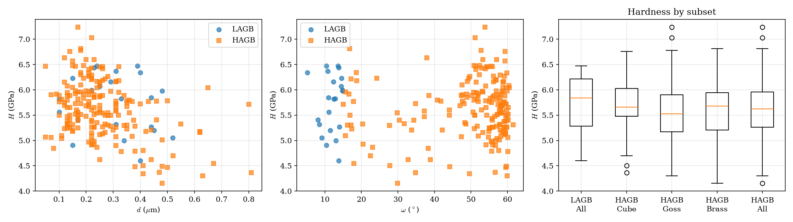
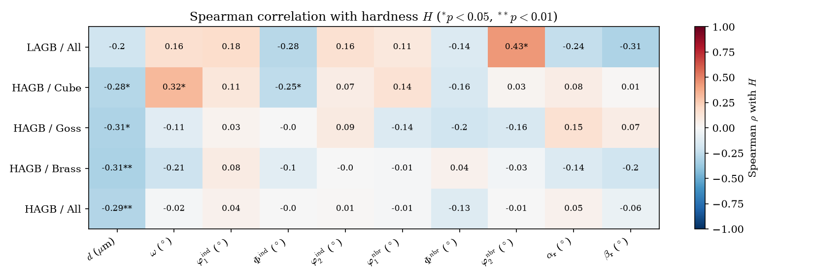
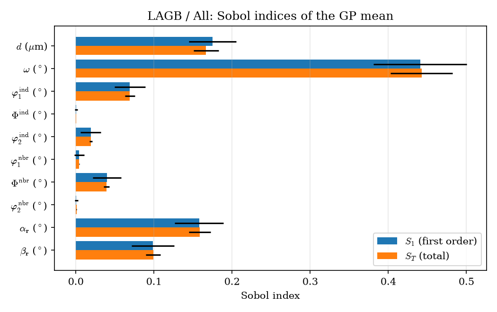
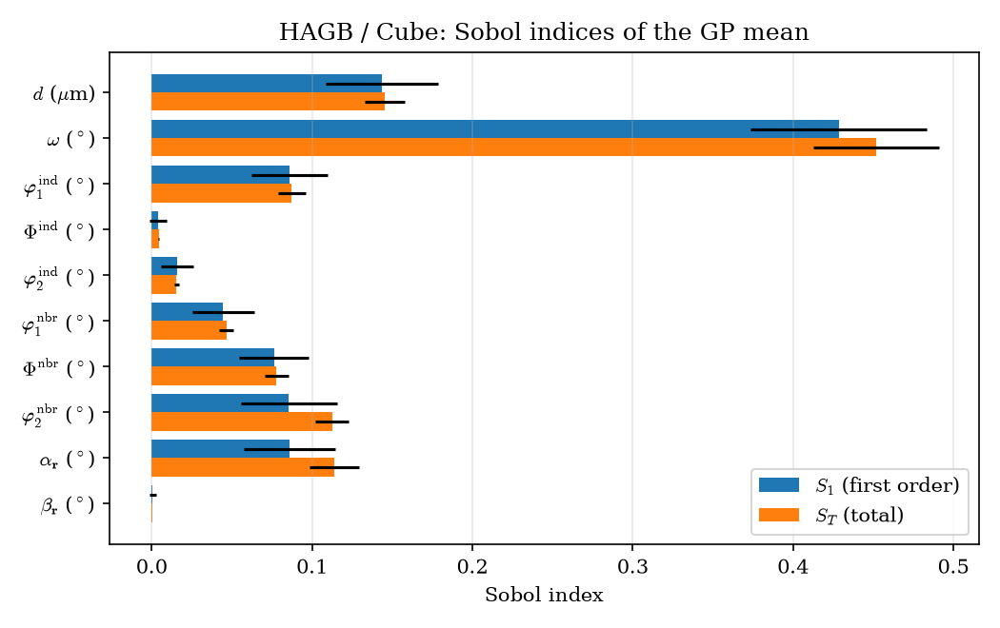
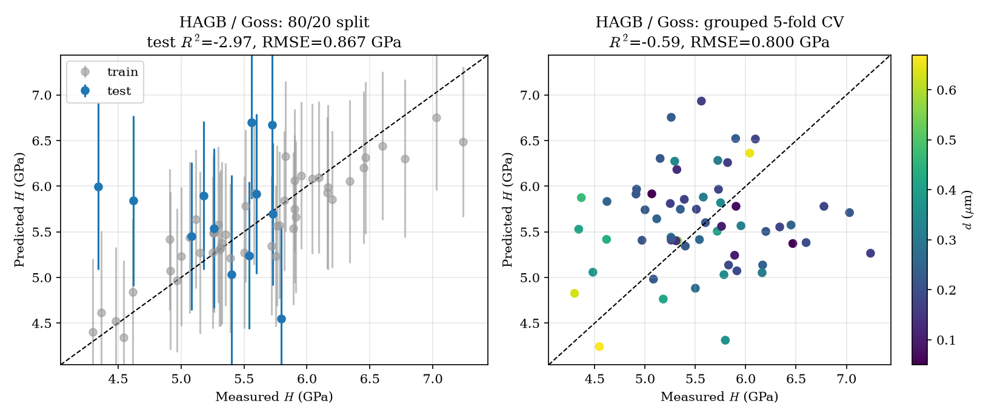
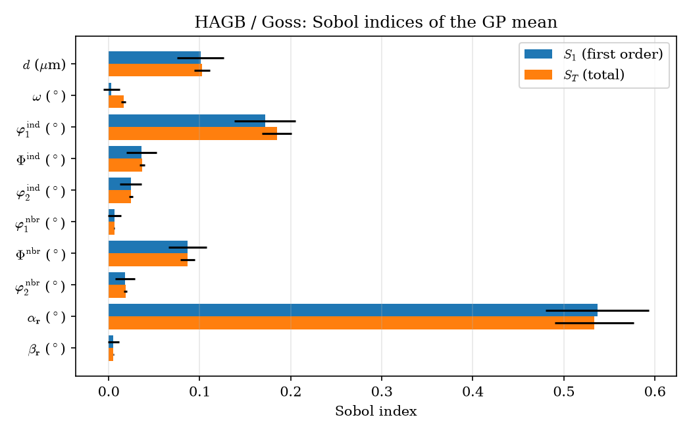
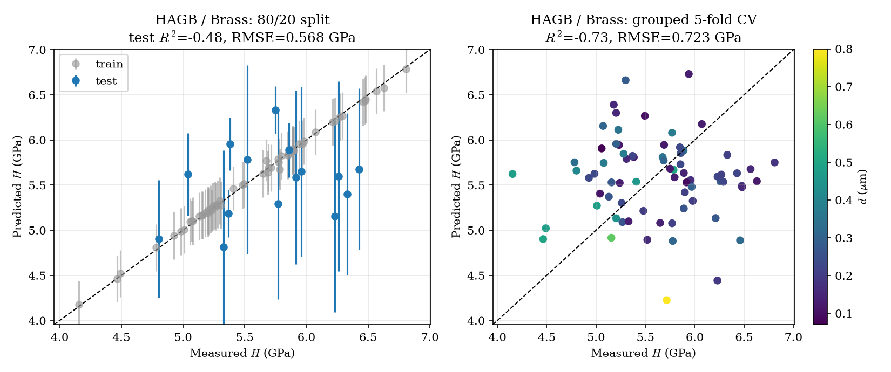
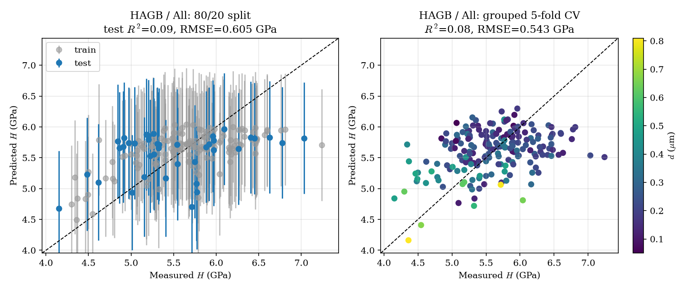
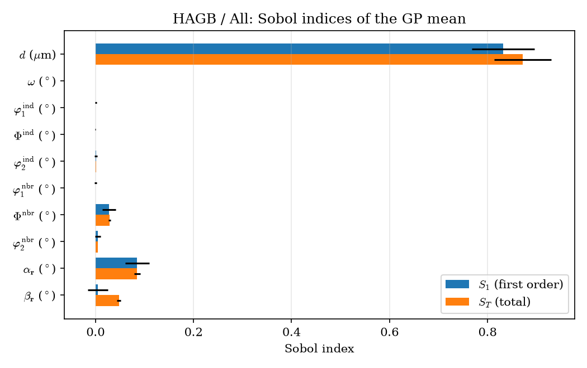
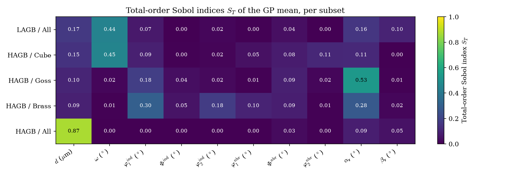

# Hardness vs. grain-boundary character: GP subset study

*Source notebook: `gp_analysis.ipynb` (cells tagged `added-subset-analysis`). Data: `data/Berkovich nanoindentation vs Block Parameters.xlsx`, sheet `H_(E-2)`. Every number in the tables is generated by those cells; CSVs are in `artifacts/`, figures in `artifacts/figures/`.*

## Summary

* **Distance from the boundary, $d$, is the only input with a consistent, significant relationship to hardness $H$.** In every HAGB subset, $H$ decreases with $d$ (Spearman $\rho$ ≈ −0.3; slope ≈ −1.4 to −1.8 GPa/µm). For HAGB / All, Sobol analysis of both GP variants attributes ~87–94% of the explained variance to $d$.
* **Predictive skill is marginal at best.** Under grouped cross-validation, the GP setup used in the notebook (Matern-3/2 ARD + linear mean) beats the trivial mean predictor only for HAGB / All, and there only slightly (CV $R^2$ = 0.08). The best model overall, a GP on $d$ alone, explains about 15% of the variance.
* **The LAGB set is too small to model** (22 indents, 10 inputs). Every model, simple ones included, does worse than the mean in cross-validation. Its results are reported as descriptive only.
* **No robust orientation or misorientation effect.** Neither the texture component of the indented grain (Kruskal–Wallis $p$ = 0.30, HAGB) nor GB type (Mann–Whitney $p$ = 0.25) shifts the hardness distribution. Wherever the GP fails to generalise, the Sobol indices of the orientation inputs change completely between equally plausible GP variants.
* **Projecting the Euler angles into the fundamental zone did not improve prediction.** Cross-validated scores with FZ-projected and as-measured angles are similar, consistent with orientation carrying little information about $H$ in this dataset.

## Data and method

**Data.** 216 indents with complete records, on 177 distinct indented grains (several indents share a grain). For each indent: hardness $H$, distance $d$ to the GB, misorientation $\omega$ (Excel column), and Bunge Euler angles of the indented and neighbouring grains.

**Notation and inputs (10).**

| Symbol | Meaning |
|---|---|
| $d$ | distance from the grain boundary (µm) |
| $\omega$ | misorientation angle across the boundary (°), from the Excel sheet |
| $(\varphi_1^{\mathrm{ind}}, \Phi^{\mathrm{ind}}, \varphi_2^{\mathrm{ind}})$ | Bunge Euler angles (Z-X-Z) of the indented grain, projected into the cubic fundamental zone |
| $(\varphi_1^{\mathrm{nbr}}, \Phi^{\mathrm{nbr}}, \varphi_2^{\mathrm{nbr}})$ | same for the neighbouring grain |
| $(\alpha_{\mathbf{r}}, \beta_{\mathbf{r}})$ | disorientation axis $\mathbf{r}$ reduced to the cubic standard triangle: $\alpha_{\mathbf{r}}$ = angle from ⟨001⟩, $\beta_{\mathbf{r}}$ = azimuth (0–45°) |

All Euler angles are projected with `project_to_fundamental_zone` before use, so every orientation has a single representation and crystal symmetry does not confound the inputs. The resulting ranges are $\varphi_1 \in [0°, 360°)$, $\varphi_2 \in [0°, 45°]$, and $\Phi \in [\cos^{-1}(\cos\varphi_2/\sqrt{1+\cos^2\varphi_2}),\ 90°]$ (≈ 45–90°).

**Subsets.**
* GB type: **LAGB: $\omega$ < 15°; HAGB: $\omega$ > 15°** (standard low-angle-boundary convention).
* LAGBs are analysed as one pooled set only.
* HAGBs are analysed in total and split by the texture component of the indented grain. The sample ND (the indentation direction), expressed in crystal axes, is assigned to the nearest of ⟨001⟩ → **Cube**, ⟨011⟩ → **Goss**, ⟨111⟩ → **Brass**, taking cubic symmetry into account. This follows the intent of `zone_classifier`, which classifies by ND only. Strictly, Goss {110}⟨001⟩ and Brass {110}⟨112⟩ both have ND ∥ ⟨110⟩, so "Brass" here means ND ∥ ⟨111⟩.

| Subset | Indents | Distinct indented grains |
|---|---|---|
| LAGB / All | 22 | 22 |
| HAGB / Cube | 62 | 49 |
| HAGB / Goss | 60 | 50 |
| HAGB / Brass | 72 | 57 |
| HAGB / All | 194 | 156 |

**Model (same as the existing notebook cells).** GPy `GPRegression`, Matern-3/2 kernel with ARD, linear mean function, MinMax scaling of inputs and output, 10 optimiser restarts, 80/20 random split (`random_state=42`).

**Error metrics.** MSE, RMSE, MAE and $R^2$ on the train and test sets, plus 95% prediction-interval coverage on the test set. With so few points a single 80/20 split is unreliable, so every subset is also evaluated with **grouped 5-fold CV**: indents in the same grain never appear in both train and test folds.

**Sensitivity indices.** Saltelli sampling with $N$ = 1024 (22,528 GP evaluations per subset) over the bounding box of each subset's inputs. First-order ($S_1$) and total-order ($S_T$) Sobol indices of the GP predictive mean, with bootstrap 95% confidence half-widths. ARD length-scales are reported alongside: in MinMax-scaled units, a large length-scale means the GP ignores that input.

**Robustness checks.**
* A *regularised GP*: constant mean, noise variance ≥ 0.05 (standardised units), length-scales bounded to [0.05, 100].
* Reference models under the same grouped CV: training mean; OLS on $d$; ridge on all inputs; regularised GP on $d$ only.
* The notebook GP refit with the as-measured (unprojected) Euler angles.

## Analysis

### Overview of the data

| Subset | n | mean $H$ | std $H$ | min $H$ | max $H$ |
|---|---|---|---|---|---|
| LAGB / All | 22 | 5.742 | 0.570 | 4.600 | 6.470 |
| HAGB / Cube | 62 | 5.681 | 0.505 | 4.361 | 6.760 |
| HAGB / Goss | 60 | 5.545 | 0.640 | 4.300 | 7.240 |
| HAGB / Brass | 72 | 5.610 | 0.554 | 4.154 | 6.810 |
| HAGB / All | 194 | 5.612 | 0.567 | 4.154 | 7.240 |

| Subset | Statistic | p |
|---|---|---|
| Kruskal-Wallis, HAGB: Cube vs Goss vs Brass | 2.389 | 0.303 |
| Mann-Whitney U, LAGB vs HAGB | 2454.000 | 0.250 |

*$H$ vs $d$ (left) and $\omega$ (middle), and by subset (right). The misorientation distribution is bimodal: LAGBs at 5–15°, and most HAGBs (152 of 194) at 45–62°, the range typical of martensite block boundaries.*

Spearman rank correlation of each input with $H$ (* $p$ < 0.05, ** $p$ < 0.01; no correction for the 50 tests):

| Subset | $d$ ($\mu$m) | $\omega$ ($^\circ$) | $\varphi_1^{\mathrm{ind}}$ ($^\circ$) | $\Phi^{\mathrm{ind}}$ ($^\circ$) | $\varphi_2^{\mathrm{ind}}$ ($^\circ$) | $\varphi_1^{\mathrm{nbr}}$ ($^\circ$) | $\Phi^{\mathrm{nbr}}$ ($^\circ$) | $\varphi_2^{\mathrm{nbr}}$ ($^\circ$) | $\alpha_{\mathbf{r}}$ ($^\circ$) | $\beta_{\mathbf{r}}$ ($^\circ$) |
|---|---|---|---|---|---|---|---|---|---|---|
| LAGB / All | -0.2 | 0.16 | 0.18 | -0.28 | 0.16 | 0.11 | -0.14 | 0.43* | -0.24 | -0.31 |
| HAGB / Cube | -0.28* | 0.32* | 0.11 | -0.25* | 0.07 | 0.14 | -0.16 | 0.03 | 0.08 | 0.01 |
| HAGB / Goss | -0.31* | -0.11 | 0.03 | -0.0 | 0.09 | -0.14 | -0.2 | -0.16 | 0.15 | 0.07 |
| HAGB / Brass | -0.31** | -0.21 | 0.08 | -0.1 | -0.0 | -0.01 | 0.04 | -0.03 | -0.14 | -0.2 |
| HAGB / All | -0.29** | -0.02 | 0.04 | -0.0 | 0.01 | -0.01 | -0.13 | -0.01 | 0.05 | -0.06 |

Linear trend of $H$ with $d$:

| Subset | slope (GPa/um) | intercept (GPa) | r | p |
|---|---|---|---|---|
| LAGB / All | -0.820 | 5.992 | -0.181 | 0.421 |
| HAGB / Cube | -1.832 | 6.146 | -0.454 | 0.000 |
| HAGB / Goss | -1.824 | 6.022 | -0.385 | 0.002 |
| HAGB / Brass | -1.415 | 5.972 | -0.346 | 0.003 |
| HAGB / All | -1.675 | 6.043 | -0.388 | 0.000 |

### Model performance overview

Notebook GP setup. Test metrics come from the 80/20 split; CV metrics from grouped 5-fold CV.

| Subset | n | Train RMSE | Train $R^2$ | Test n | Test MSE | Test RMSE | Test MAE | Test $R^2$ | Test 95% PI cov. | CV folds | CV RMSE | CV $R^2$ |
|---|---|---|---|---|---|---|---|---|---|---|---|---|
| LAGB / All | 22 | 0.000 | 1.000 | 5 | 2.383 | 1.544 | 1.370 | -4.121 | 0.000 | 5 | 1.254 | -4.067 |
| HAGB / Cube | 62 | 0.000 | 1.000 | 13 | 0.205 | 0.453 | 0.376 | 0.448 | 0.846 | 5 | 0.522 | -0.086 |
| HAGB / Goss | 60 | 0.279 | 0.824 | 12 | 0.752 | 0.867 | 0.715 | -2.970 | 0.583 | 5 | 0.800 | -0.587 |
| HAGB / Brass | 72 | 0.030 | 0.997 | 15 | 0.323 | 0.568 | 0.491 | -0.476 | 0.667 | 5 | 0.723 | -0.730 |
| HAGB / All | 194 | 0.444 | 0.334 | 39 | 0.366 | 0.605 | 0.525 | 0.091 | 0.923 | 5 | 0.543 | 0.077 |

### Low-angle grain boundaries (ω < 15°): all 22 indents

> **Small-sample warning.** The LAGB set has 22 indents, each on a different grain, against 10 inputs. The 80/20 split trains on 17 points and tests on 5. Treat everything in this subsection as descriptive.

### LAGB / All

$n$ = 22 indents (22 distinct indented grains); 80/20 split → 17 train / 5 test; grouped CV with 5 folds.

| Metric | Value |
|---|---|
| Train RMSE (GPa) | 0.000 |
| Train $R^2$ | 1.000 |
| Test RMSE (GPa) | 1.544 |
| Test MAE (GPa) | 1.370 |
| Test $R^2$ | -4.121 |
| Test 95% PI coverage | 0.000 |
| Grouped-CV RMSE (GPa) | 1.254 |
| Grouped-CV $R^2$ | -4.067 |
| Grouped-CV RMSE, mean predictor (GPa) | 0.585 |
| Grouped-CV $R^2$, regularised GP | -0.552 |

*Left: 80/20 split (error bars = ±1.96σ predictive). Right: grouped-CV predictions coloured by distance $d$ from the GB.*

| Input | $S_1$ | ±conf | $S_T$ | ±conf | $S_T$ (reg. GP) | ARD length-scale | Spearman $\rho$ | $p$ |
|---|---|---|---|---|---|---|---|---|
| $d$ ($\mu$m) | 0.175 | 0.030 | 0.167 | 0.016 | 0.142 | 2.4e+03 | -0.20 | 0.383 |
| $\omega$ ($^\circ$) | 0.441 | 0.060 | 0.443 | 0.040 | 0.000 | 0.554 | 0.16 | 0.487 |
| $\varphi_1^{\mathrm{ind}}$ ($^\circ$) | 0.069 | 0.020 | 0.069 | 0.006 | 0.770 | 5.01e+04 | 0.18 | 0.428 |
| $\Phi^{\mathrm{ind}}$ ($^\circ$) | 0.000 | 0.002 | 0.000 | 0.000 | 0.000 | 4.08e+04 | -0.28 | 0.206 |
| $\varphi_2^{\mathrm{ind}}$ ($^\circ$) | 0.019 | 0.013 | 0.019 | 0.002 | 0.000 | 6.01e+03 | 0.16 | 0.490 |
| $\varphi_1^{\mathrm{nbr}}$ ($^\circ$) | 0.004 | 0.007 | 0.004 | 0.000 | 0.000 | 3.92e+04 | 0.11 | 0.636 |
| $\Phi^{\mathrm{nbr}}$ ($^\circ$) | 0.040 | 0.018 | 0.040 | 0.004 | 0.654 | 2.78e+04 | -0.14 | 0.533 |
| $\varphi_2^{\mathrm{nbr}}$ ($^\circ$) | 0.001 | 0.002 | 0.001 | 0.000 | 0.000 | 2.5e+04 | 0.43 | 0.044 |
| $\alpha_{\mathbf{r}}$ ($^\circ$) | 0.158 | 0.031 | 0.159 | 0.014 | 0.000 | 4.06e+04 | -0.24 | 0.289 |
| $\beta_{\mathbf{r}}$ ($^\circ$) | 0.099 | 0.027 | 0.099 | 0.009 | 0.000 | 6.65e+03 | -0.31 | 0.162 |

**Only 22 indents, one per grain, against 10 inputs.** The 80/20 split leaves 17 training points to fit 10 ARD length-scales, 10 linear-mean slopes, a signal variance and a noise variance. The model interpolates the training data exactly (train $R^2$ = 1) and fails badly on held-out indents: test $R^2$ ≈ −4.1 on the 5 test points, and grouped-CV RMSE 1.25 GPa vs 0.59 GPa for simply predicting the mean. No model tried does better than the mean here, including ridge, a distance-only fit and the regularised GP. The two GP variants also rank the inputs completely differently: the notebook GP puts $\omega$ first ($S_T$ = 0.44), while the regularised GP puts $\varphi_1^{\mathrm{ind}}$ and $\Phi^{\mathrm{nbr}}$ first. Neither ranking reflects the material. The only nominally significant correlation, $\varphi_2^{\mathrm{nbr}}$ ($\rho$ = 0.43, $p$ < 0.05), is one of 50 tests in the Spearman table, where about 2–3 false positives are expected by chance. **These LAGB results are descriptive only.** Hardness near LAGBs (5.74 ± 0.57 GPa) is statistically indistinguishable from that near HAGBs (Mann–Whitney $p$ = 0.25).

### High-angle grain boundaries (ω > 15°)

#### HAGB / Cube

$n$ = 62 indents (49 distinct indented grains); 80/20 split → 49 train / 13 test; grouped CV with 5 folds.

| Metric | Value |
|---|---|
| Train RMSE (GPa) | 0.000 |
| Train $R^2$ | 1.000 |
| Test RMSE (GPa) | 0.453 |
| Test MAE (GPa) | 0.376 |
| Test $R^2$ | 0.448 |
| Test 95% PI coverage | 0.846 |
| Grouped-CV RMSE (GPa) | 0.522 |
| Grouped-CV $R^2$ | -0.086 |
| Grouped-CV RMSE, mean predictor (GPa) | 0.510 |
| Grouped-CV $R^2$, regularised GP | 0.093 |

*Left: 80/20 split (error bars = ±1.96σ predictive). Right: grouped-CV predictions coloured by distance $d$ from the GB.*

| Input | $S_1$ | ±conf | $S_T$ | ±conf | $S_T$ (reg. GP) | ARD length-scale | Spearman $\rho$ | $p$ |
|---|---|---|---|---|---|---|---|---|
| $d$ ($\mu$m) | 0.143 | 0.035 | 0.145 | 0.013 | 0.428 | 2.83e+03 | -0.28 | 0.026 |
| $\omega$ ($^\circ$) | 0.429 | 0.055 | 0.452 | 0.039 | 0.434 | 0.0358 | 0.32 | 0.011 |
| $\varphi_1^{\mathrm{ind}}$ ($^\circ$) | 0.086 | 0.024 | 0.087 | 0.008 | 0.000 | 415 | 0.11 | 0.383 |
| $\Phi^{\mathrm{ind}}$ ($^\circ$) | 0.004 | 0.005 | 0.004 | 0.000 | 0.000 | 664 | -0.25 | 0.046 |
| $\varphi_2^{\mathrm{ind}}$ ($^\circ$) | 0.016 | 0.010 | 0.015 | 0.001 | 0.000 | 741 | 0.07 | 0.574 |
| $\varphi_1^{\mathrm{nbr}}$ ($^\circ$) | 0.045 | 0.019 | 0.047 | 0.005 | 0.000 | 1.95e+03 | 0.14 | 0.274 |
| $\Phi^{\mathrm{nbr}}$ ($^\circ$) | 0.076 | 0.022 | 0.078 | 0.008 | 0.086 | 1.14e+03 | -0.16 | 0.217 |
| $\varphi_2^{\mathrm{nbr}}$ ($^\circ$) | 0.086 | 0.030 | 0.112 | 0.010 | 0.313 | 0.0766 | 0.03 | 0.819 |
| $\alpha_{\mathbf{r}}$ ($^\circ$) | 0.086 | 0.029 | 0.114 | 0.015 | 0.000 | 0.0714 | 0.08 | 0.560 |
| $\beta_{\mathbf{r}}$ ($^\circ$) | 0.000 | 0.002 | 0.001 | 0.000 | 0.000 | 961 | 0.01 | 0.950 |

The 80/20 split looks good (test $R^2$ = 0.45), but grouped CV gives −0.09: the single split was favourable. Three inputs correlate significantly with $H$: $d$ ($\rho$ = −0.28), $\omega$ ($\rho$ = +0.32) and $\Phi^{\mathrm{ind}}$ ($\rho$ = −0.25). The regularised GP is one of only two subset models that beat the mean predictor (CV $R^2$ = 0.09), and both GP variants give $\omega$ a large total index ($S_T$ ≈ 0.43–0.45). Linear models on $d$ alone or on all inputs reach CV $R^2$ ≈ 0.16, so the signal is weak and mostly monotone. A positive $\omega$ effect for Cube-oriented grains is therefore a candidate, not an established, trend.

#### HAGB / Goss

$n$ = 60 indents (50 distinct indented grains); 80/20 split → 48 train / 12 test; grouped CV with 5 folds.

| Metric | Value |
|---|---|
| Train RMSE (GPa) | 0.279 |
| Train $R^2$ | 0.824 |
| Test RMSE (GPa) | 0.867 |
| Test MAE (GPa) | 0.715 |
| Test $R^2$ | -2.970 |
| Test 95% PI coverage | 0.583 |
| Grouped-CV RMSE (GPa) | 0.800 |
| Grouped-CV $R^2$ | -0.587 |
| Grouped-CV RMSE, mean predictor (GPa) | 0.664 |
| Grouped-CV $R^2$, regularised GP | -0.357 |

*Left: 80/20 split (error bars = ±1.96σ predictive). Right: grouped-CV predictions coloured by distance $d$ from the GB.*

| Input | $S_1$ | ±conf | $S_T$ | ±conf | $S_T$ (reg. GP) | ARD length-scale | Spearman $\rho$ | $p$ |
|---|---|---|---|---|---|---|---|---|
| $d$ ($\mu$m) | 0.101 | 0.026 | 0.103 | 0.009 | 0.850 | 6.17e+03 | -0.31 | 0.016 |
| $\omega$ ($^\circ$) | 0.003 | 0.009 | 0.016 | 0.002 | 0.003 | 1.08 | -0.11 | 0.405 |
| $\varphi_1^{\mathrm{ind}}$ ($^\circ$) | 0.172 | 0.034 | 0.185 | 0.016 | 0.000 | 0.0588 | 0.03 | 0.797 |
| $\Phi^{\mathrm{ind}}$ ($^\circ$) | 0.036 | 0.016 | 0.037 | 0.003 | 0.000 | 9.45e+03 | -0.00 | 0.974 |
| $\varphi_2^{\mathrm{ind}}$ ($^\circ$) | 0.024 | 0.012 | 0.025 | 0.002 | 0.000 | 9.49e+03 | 0.09 | 0.502 |
| $\varphi_1^{\mathrm{nbr}}$ ($^\circ$) | 0.006 | 0.007 | 0.006 | 0.001 | 0.000 | 4.7e+03 | -0.14 | 0.289 |
| $\Phi^{\mathrm{nbr}}$ ($^\circ$) | 0.086 | 0.021 | 0.087 | 0.008 | 0.149 | 2.77e+03 | -0.20 | 0.130 |
| $\varphi_2^{\mathrm{nbr}}$ ($^\circ$) | 0.018 | 0.011 | 0.018 | 0.002 | 0.000 | 2.54e+04 | -0.16 | 0.226 |
| $\alpha_{\mathbf{r}}$ ($^\circ$) | 0.537 | 0.057 | 0.533 | 0.043 | 0.145 | 5.63e+03 | 0.15 | 0.253 |
| $\beta_{\mathbf{r}}$ ($^\circ$) | 0.005 | 0.006 | 0.005 | 0.000 | 0.000 | 1.43e+03 | 0.07 | 0.582 |

The model overfits (train $R^2$ = 0.82, CV $R^2$ = −0.59). The notebook GP attributes half the variance to the disorientation-axis angle $\alpha_{\mathbf{r}}$ ($S_T$ = 0.53). The regularised GP, which also fails to beat the mean, attributes 85% to $d$. Only $d$ is significantly correlated with $H$ ($\rho$ = −0.31). Here the unprojected Euler angles happen to give a better CV score than the fundamental-zone ones (see robustness checks). With one split of 60 points, that difference is within the noise of the fitting.

#### HAGB / Brass

$n$ = 72 indents (57 distinct indented grains); 80/20 split → 57 train / 15 test; grouped CV with 5 folds.

| Metric | Value |
|---|---|
| Train RMSE (GPa) | 0.030 |
| Train $R^2$ | 0.997 |
| Test RMSE (GPa) | 0.568 |
| Test MAE (GPa) | 0.491 |
| Test $R^2$ | -0.476 |
| Test 95% PI coverage | 0.667 |
| Grouped-CV RMSE (GPa) | 0.723 |
| Grouped-CV $R^2$ | -0.730 |
| Grouped-CV RMSE, mean predictor (GPa) | 0.557 |
| Grouped-CV $R^2$, regularised GP | -0.070 |

*Left: 80/20 split (error bars = ±1.96σ predictive). Right: grouped-CV predictions coloured by distance $d$ from the GB.*

| Input | $S_1$ | ±conf | $S_T$ | ±conf | $S_T$ (reg. GP) | ARD length-scale | Spearman $\rho$ | $p$ |
|---|---|---|---|---|---|---|---|---|
| $d$ ($\mu$m) | 0.087 | 0.023 | 0.093 | 0.009 | 0.904 | 1.47e+03 | -0.31 | 0.007 |
| $\omega$ ($^\circ$) | 0.005 | 0.007 | 0.005 | 0.001 | 0.000 | 1.06e+03 | -0.21 | 0.082 |
| $\varphi_1^{\mathrm{ind}}$ ($^\circ$) | 0.200 | 0.052 | 0.303 | 0.039 | 0.166 | 0.0248 | 0.08 | 0.478 |
| $\Phi^{\mathrm{ind}}$ ($^\circ$) | 0.010 | 0.017 | 0.054 | 0.009 | 0.000 | 0.385 | -0.10 | 0.392 |
| $\varphi_2^{\mathrm{ind}}$ ($^\circ$) | 0.170 | 0.037 | 0.179 | 0.017 | 0.474 | 0.745 | -0.00 | 0.969 |
| $\varphi_1^{\mathrm{nbr}}$ ($^\circ$) | 0.102 | 0.032 | 0.102 | 0.010 | 0.000 | 1.31e+03 | -0.01 | 0.920 |
| $\Phi^{\mathrm{nbr}}$ ($^\circ$) | 0.083 | 0.024 | 0.085 | 0.008 | 0.000 | 1.63 | 0.04 | 0.740 |
| $\varphi_2^{\mathrm{nbr}}$ ($^\circ$) | 0.009 | 0.007 | 0.008 | 0.001 | 0.000 | 1.44e+03 | -0.03 | 0.819 |
| $\alpha_{\mathbf{r}}$ ($^\circ$) | 0.216 | 0.045 | 0.279 | 0.032 | 0.000 | 0.385 | -0.14 | 0.250 |
| $\beta_{\mathbf{r}}$ ($^\circ$) | 0.015 | 0.012 | 0.019 | 0.002 | 0.049 | 1.14 | -0.20 | 0.093 |

The model overfits (train $R^2$ = 0.997, CV $R^2$ = −0.73). The notebook GP spreads its sensitivity over $\varphi_1^{\mathrm{ind}}$, $\alpha_{\mathbf{r}}$ and $\varphi_2^{\mathrm{ind}}$; the regularised GP gives $d$ 90%. Only $d$ is significant ($\rho$ = −0.31, $p$ < 0.01). The best model is a one-dimensional GP on $d$ alone (CV $R^2$ = 0.11).

#### HAGB / All

$n$ = 194 indents (156 distinct indented grains); 80/20 split → 155 train / 39 test; grouped CV with 5 folds.

| Metric | Value |
|---|---|
| Train RMSE (GPa) | 0.444 |
| Train $R^2$ | 0.334 |
| Test RMSE (GPa) | 0.605 |
| Test MAE (GPa) | 0.525 |
| Test $R^2$ | 0.091 |
| Test 95% PI coverage | 0.923 |
| Grouped-CV RMSE (GPa) | 0.543 |
| Grouped-CV $R^2$ | 0.077 |
| Grouped-CV RMSE, mean predictor (GPa) | 0.567 |
| Grouped-CV $R^2$, regularised GP | 0.108 |

*Left: 80/20 split (error bars = ±1.96σ predictive). Right: grouped-CV predictions coloured by distance $d$ from the GB.*

| Input | $S_1$ | ±conf | $S_T$ | ±conf | $S_T$ (reg. GP) | ARD length-scale | Spearman $\rho$ | $p$ |
|---|---|---|---|---|---|---|---|---|
| $d$ ($\mu$m) | 0.832 | 0.064 | 0.872 | 0.058 | 0.944 | 0.612 | -0.29 | 0.000 |
| $\omega$ ($^\circ$) | 0.000 | 0.000 | 0.000 | 0.000 | 0.000 | 3.34e+04 | -0.02 | 0.786 |
| $\varphi_1^{\mathrm{ind}}$ ($^\circ$) | 0.000 | 0.002 | 0.000 | 0.000 | 0.000 | 1.42e+03 | 0.04 | 0.561 |
| $\Phi^{\mathrm{ind}}$ ($^\circ$) | 0.000 | 0.001 | 0.000 | 0.000 | 0.000 | 6.29e+03 | -0.00 | 0.994 |
| $\varphi_2^{\mathrm{ind}}$ ($^\circ$) | 0.001 | 0.003 | 0.001 | 0.000 | 0.000 | 1.12e+04 | 0.01 | 0.908 |
| $\varphi_1^{\mathrm{nbr}}$ ($^\circ$) | 0.001 | 0.002 | 0.001 | 0.000 | 0.000 | 8.45e+03 | -0.01 | 0.911 |
| $\Phi^{\mathrm{nbr}}$ ($^\circ$) | 0.028 | 0.014 | 0.028 | 0.002 | 0.024 | 7.37e+03 | -0.13 | 0.065 |
| $\varphi_2^{\mathrm{nbr}}$ ($^\circ$) | 0.005 | 0.005 | 0.005 | 0.000 | 0.000 | 1.56e+04 | -0.01 | 0.927 |
| $\alpha_{\mathbf{r}}$ ($^\circ$) | 0.085 | 0.025 | 0.085 | 0.006 | 0.029 | 1.35e+03 | 0.05 | 0.528 |
| $\beta_{\mathbf{r}}$ ($^\circ$) | 0.004 | 0.021 | 0.048 | 0.004 | 0.008 | 2.85 | -0.06 | 0.386 |

**The one subset where the analyses agree.** With 194 indents on 156 grains, the notebook GP beats the mean predictor in grouped CV, if only just (CV $R^2$ = 0.08, RMSE 0.543 vs 0.567 GPa). Distance dominates every sensitivity measure: $S_T$ = 0.87 for the notebook GP and 0.94 for the regularised GP; the ARD length-scale of $d$ is 0.6, against more than 1,000 for every other input except $\beta_{\mathbf{r}}$ (2.9); and Spearman $\rho$ = −0.29 with $p$ < 0.001. The total indices of all other inputs (both grains' Euler angles, $\omega$ and the disorientation axis) sum to only ≈ 0.17 for the notebook GP and ≈ 0.06 for the regularised GP. The best model is still a GP on $d$ alone (CV $R^2$ = 0.15), so adding the orientation inputs does not improve prediction. Hardness falls by ≈ 1.7 GPa per µm away from the boundary.

### Sensitivity indices across subsets

Total-order indices $S_T$, notebook GP:

| Subset | $d$ ($\mu$m) | $\omega$ ($^\circ$) | $\varphi_1^{\mathrm{ind}}$ ($^\circ$) | $\Phi^{\mathrm{ind}}$ ($^\circ$) | $\varphi_2^{\mathrm{ind}}$ ($^\circ$) | $\varphi_1^{\mathrm{nbr}}$ ($^\circ$) | $\Phi^{\mathrm{nbr}}$ ($^\circ$) | $\varphi_2^{\mathrm{nbr}}$ ($^\circ$) | $\alpha_{\mathbf{r}}$ ($^\circ$) | $\beta_{\mathbf{r}}$ ($^\circ$) |
|---|---|---|---|---|---|---|---|---|---|---|
| LAGB / All | 0.167 | 0.443 | 0.069 | 0.000 | 0.019 | 0.004 | 0.040 | 0.001 | 0.159 | 0.099 |
| HAGB / Cube | 0.145 | 0.452 | 0.087 | 0.004 | 0.015 | 0.047 | 0.078 | 0.112 | 0.114 | 0.001 |
| HAGB / Goss | 0.103 | 0.016 | 0.185 | 0.037 | 0.025 | 0.006 | 0.087 | 0.018 | 0.533 | 0.005 |
| HAGB / Brass | 0.093 | 0.005 | 0.303 | 0.054 | 0.179 | 0.102 | 0.085 | 0.008 | 0.279 | 0.019 |
| HAGB / All | 0.872 | 0.000 | 0.000 | 0.000 | 0.001 | 0.001 | 0.028 | 0.005 | 0.085 | 0.048 |

First-order indices $S_1$, notebook GP:

| Subset | $d$ ($\mu$m) | $\omega$ ($^\circ$) | $\varphi_1^{\mathrm{ind}}$ ($^\circ$) | $\Phi^{\mathrm{ind}}$ ($^\circ$) | $\varphi_2^{\mathrm{ind}}$ ($^\circ$) | $\varphi_1^{\mathrm{nbr}}$ ($^\circ$) | $\Phi^{\mathrm{nbr}}$ ($^\circ$) | $\varphi_2^{\mathrm{nbr}}$ ($^\circ$) | $\alpha_{\mathbf{r}}$ ($^\circ$) | $\beta_{\mathbf{r}}$ ($^\circ$) |
|---|---|---|---|---|---|---|---|---|---|---|
| LAGB / All | 0.175 | 0.441 | 0.069 | 0.000 | 0.019 | 0.004 | 0.040 | 0.001 | 0.158 | 0.099 |
| HAGB / Cube | 0.143 | 0.429 | 0.086 | 0.004 | 0.016 | 0.045 | 0.076 | 0.086 | 0.086 | 0.000 |
| HAGB / Goss | 0.101 | 0.003 | 0.172 | 0.036 | 0.024 | 0.006 | 0.086 | 0.018 | 0.537 | 0.005 |
| HAGB / Brass | 0.087 | 0.005 | 0.200 | 0.010 | 0.170 | 0.102 | 0.083 | 0.009 | 0.216 | 0.015 |
| HAGB / All | 0.832 | 0.000 | 0.000 | 0.000 | 0.001 | 0.001 | 0.028 | 0.005 | 0.085 | 0.004 |

Total-order indices $S_T$, regularised GP. The last column marks whether that model beats the mean predictor in grouped CV, i.e. whether its indices are worth interpreting:

| Subset | $d$ ($\mu$m) | $\omega$ ($^\circ$) | $\varphi_1^{\mathrm{ind}}$ ($^\circ$) | $\Phi^{\mathrm{ind}}$ ($^\circ$) | $\varphi_2^{\mathrm{ind}}$ ($^\circ$) | $\varphi_1^{\mathrm{nbr}}$ ($^\circ$) | $\Phi^{\mathrm{nbr}}$ ($^\circ$) | $\varphi_2^{\mathrm{nbr}}$ ($^\circ$) | $\alpha_{\mathbf{r}}$ ($^\circ$) | $\beta_{\mathbf{r}}$ ($^\circ$) | beats mean in CV |
|---|---|---|---|---|---|---|---|---|---|---|---|
| LAGB / All | 0.142 | 0.000 | 0.770 | 0.000 | 0.000 | 0.000 | 0.654 | 0.000 | 0.000 | 0.000 | False |
| HAGB / Cube | 0.428 | 0.434 | 0.000 | 0.000 | 0.000 | 0.000 | 0.086 | 0.313 | 0.000 | 0.000 | True |
| HAGB / Goss | 0.850 | 0.003 | 0.000 | 0.000 | 0.000 | 0.000 | 0.149 | 0.000 | 0.145 | 0.000 | False |
| HAGB / Brass | 0.904 | 0.000 | 0.166 | 0.000 | 0.474 | 0.000 | 0.000 | 0.000 | 0.000 | 0.049 | False |
| HAGB / All | 0.944 | 0.000 | 0.000 | 0.000 | 0.000 | 0.000 | 0.024 | 0.000 | 0.029 | 0.008 | True |

### Robustness checks

**Model comparison, grouped-CV $R^2$.** Positive values mean better than predicting the training mean.

| Subset | mean | OLS ($d$ only) | Ridge (all) | GP-reg ($d$ only) | GP-reg (all) | GP (notebook setup) |
|---|---|---|---|---|---|---|
| LAGB / All | -0.103 | -0.256 | -0.162 | -0.182 | -0.552 | -4.067 |
| HAGB / Cube | -0.035 | 0.159 | 0.157 | 0.045 | 0.093 | -0.086 |
| HAGB / Goss | -0.093 | 0.020 | -0.073 | -0.077 | -0.357 | -0.587 |
| HAGB / Brass | -0.025 | 0.071 | -0.062 | 0.109 | -0.070 | -0.730 |
| HAGB / All | -0.003 | 0.129 | 0.119 | 0.148 | 0.108 | 0.077 |

Grouped-CV RMSE (GPa):

| Subset | mean | OLS ($d$ only) | Ridge (all) | GP-reg ($d$ only) | GP-reg (all) | GP (notebook setup) |
|---|---|---|---|---|---|---|
| LAGB / All | 0.585 | 0.624 | 0.600 | 0.606 | 0.694 | 1.254 |
| HAGB / Cube | 0.510 | 0.460 | 0.460 | 0.490 | 0.477 | 0.522 |
| HAGB / Goss | 0.664 | 0.628 | 0.658 | 0.659 | 0.740 | 0.800 |
| HAGB / Brass | 0.557 | 0.530 | 0.567 | 0.519 | 0.569 | 0.723 |
| HAGB / All | 0.567 | 0.528 | 0.531 | 0.522 | 0.534 | 0.543 |

**Fundamental-zone vs as-measured Euler angles** (notebook GP setup, grouped CV):

| Subset | CV RMSE (FZ) | CV $R^2$ (FZ) | CV RMSE (raw) | CV $R^2$ (raw) |
|---|---|---|---|---|
| LAGB / All | 1.254 | -4.067 | 1.436 | -5.652 |
| HAGB / Cube | 0.522 | -0.086 | 0.562 | -0.258 |
| HAGB / Goss | 0.800 | -0.587 | 0.622 | 0.040 |
| HAGB / Brass | 0.723 | -0.730 | 0.715 | -0.693 |
| HAGB / All | 0.543 | 0.077 | 0.546 | 0.069 |

### Data and code consistency checks

* After the fixes to `rotation_matrix.py` and `fundamental_zone.py`: the `rotation_matrix` ↔ `rotation_matrix_to_euler` round trip is exact (0/500 failures), and `project_to_fundamental_zone` returns an orientation in the FZ, crystal-symmetry equivalent to its input, in 500/500 random tests.
* `zone_classifier` still disagrees with the symmetry-aware ND classification on most indents (agreement 38.9%), so it is not used here:

| Subset | Brass | Cube | Goss | All |
|---|---|---|---|---|
| Brass | 45 | 22 | 41 | 108 |
| Cube | 35 | 36 | 24 | 95 |
| Goss | 0 | 10 | 3 | 13 |
| All | 80 | 68 | 68 | 216 |

* The disorientation computed from the two grains' Euler angles differs from the Excel $\omega$ column by a median of 1.8° (90th percentile 6.0°, maximum 38.9°). 99 of 216 rows differ by more than 2°, and 8 rows would switch GB type if the computed value were used. The subsets use the Excel value.

## Discussion

**1. Distance from the boundary is the only reproducible signal, and it is weak.** In all three HAGB texture subsets, $H$ falls with $d$ at almost the same rate (−1.8, −1.8 and −1.4 GPa/µm for Cube, Goss and Brass; $r$ = −0.35 to −0.45; $p$ ≤ 0.003). For HAGB / All, every method ranks $d$ first: Spearman, linear regression, the notebook GP ($S_T$ = 0.87), the regularised GP ($S_T$ = 0.94), and the ARD length-scales. This is consistent with boundary strengthening: within a few hundred nanometres of a boundary, the indentation plastic zone reaches the boundary, and dislocation pile-up or blocked slip transfer raises the measured hardness. The texture component does not change the gradient appreciably, which suggests the effect comes from the boundary rather than from the indented crystal's orientation.

The effect is nonetheless small. The best cross-validated model (a GP on $d$ alone, HAGB / All) explains about 15% of the variance, and its residual RMSE (0.52 GPa) is close to the raw standard deviation of $H$ (0.57 GPa). Only 10 indents lie beyond 0.5 µm, so the far-field (bulk) hardness, and with it the length scale of the gradient, is poorly constrained.

**2. Orientation and misorientation show no robust effect.** Hardness distributions overlap across Cube, Goss and Brass (Kruskal–Wallis $p$ = 0.30) and between LAGB and HAGB (Mann–Whitney $p$ = 0.25). Weak Berkovich-hardness anisotropy is expected in a cubic metal: the three-sided pyramid activates many slip systems whatever the ND direction. Seven of the 50 Spearman tests are significant at $\alpha$ = 0.05, where about 2–3 are expected by chance. Four of the seven are the distance correlations of the HAGB subsets. The other three are single-subset results that no other analysis reproduces: $\omega$ and $\Phi^{\mathrm{ind}}$ in HAGB / Cube, and $\varphi_2^{\mathrm{nbr}}$ in LAGB. The positive $\omega$ effect in HAGB / Cube is the only one that also carries a large Sobol index in both GP variants, so it is the best candidate to test with more data. The bimodal $\omega$ distribution also limits what can be resolved: within each GB type, $\omega$ spans a narrow range.

**3. Why most GP fits fail, and what the Sobol indices mean.**
* *Overfitting.* With MinMax-scaled outputs and no noise prior, maximum-likelihood fitting drives the noise variance to almost zero in most subsets. The model then interpolates the training data (train $R^2$ ≥ 0.99 in three of the five subsets) and reverts to its mean function away from them. The linear mean with 10 free slopes is especially harmful when there are few points (LAGB).
* *A single split is misleading.* HAGB / Cube has test $R^2$ = +0.45 on its 80/20 split but −0.09 under grouped CV. Read the split metrics in the parity plots together with the CV metrics.
* *Sobol indices describe the fitted model, not the material.* They are interpretable only where the model generalises: HAGB / All and, marginally, HAGB / Cube. Elsewhere they change completely between equally poor models. For example, HAGB / Goss gets $\alpha_{\mathbf{r}}$ = 0.53 from the notebook GP and $d$ = 0.85 from the regularised one; HAGB / Brass gets $\varphi_1^{\mathrm{ind}}$ = 0.30 vs $d$ = 0.90. The Sobol sampling also assumes independent, uniform inputs over a box, while the real inputs are correlated (e.g. the disorientation depends on both grains' orientations) and the FZ is not a box: the lower bound of $\Phi$ depends on $\varphi_2$. Part of the sampled space is therefore off-data, where the GP returns its prior mean.

**4. Fundamental-zone projection: necessary, but not sufficient.** Projecting removes the 24-fold ambiguity of each orientation, which is required for the inputs to mean anything. It does not, however, make Euler angles a good input for a stationary kernel:
* $\varphi_1$ is periodic, so $\varphi_1$ = 1° and 359° describe nearly the same sample-frame rotation but are maximally far apart for the kernel.
* Orientations close to an FZ boundary can map to distant points after projection.
* The Euler metric is non-uniform: near $\Phi$ → 0, $\varphi_1$ and $\varphi_2$ become degenerate (less relevant here, since $\Phi$ ≥ 45° in this FZ).

The CV comparison with as-measured angles shows no consistent gain or loss from projecting, which mainly reflects that the orientation inputs carry little predictive information in these data.

**5. LAGBs: descriptive only.** 22 indents on 22 grains cannot support a 10-input regression. Every model tried, including simple linear ones, predicts worse than the LAGB mean in cross-validation. The GP's Sobol ranking ($\omega$ first) is contradicted by the regularised GP ($\varphi_1^{\mathrm{ind}}$, $\Phi^{\mathrm{nbr}}$ first). The data show no evidence that hardness near LAGBs differs from that near HAGBs ($p$ = 0.25), nor that it depends on $d$ ($r$ = −0.18, $p$ = 0.42). Distinguishing a LAGB effect would need several times more indents.

**6. Recommendations.**
1. Use far fewer, physically motivated inputs. Candidates: $d$ (or $d$ normalised by indentation depth or plastic-zone size, if available), GB type, and slip-transfer descriptors that summarise both grains and the boundary in one number, such as the Schmid factors of the two grains or the Luster–Morris $m'$. These target the mechanism behind boundary strengthening better than six Euler angles and an axis.
2. If orientations stay as inputs, encode them in a way a kernel can use: e.g. $\cos\varphi_1$ and $\sin\varphi_1$, unit quaternions or Rodrigues vectors in the FZ, or a misorientation-aware kernel.
3. Pool the HAGB subsets and include the texture component (or ND direction) as an input instead of fitting separate models. Fix or regularise the GP noise and drop the linear mean.
4. Collect more indents next to LAGBs (at least 50–100) and more indents far from boundaries (> 0.5 µm), to pin down the bulk hardness and the length scale of the gradient.
5. Resolve the 8 indents whose GB type depends on whether $\omega$ is taken from the Excel column or computed from the Euler angles.

## Remaining issues in the existing code

| Location | Issue | Effect |
|---|---|---|
| `scripts/utils/scratch.py::zone_classifier` | Now that `rotation_matrix` returns g (sample → crystal), `rot.T @ [0,0,1]` gives the crystal [001] axis in sample axes; the ND in crystal axes is `rot @ [0,0,1]`. It also compares with fixed vectors ([100], [110], [111]) instead of the nearest symmetric equivalent, e.g. using sorted absolute components. | Agrees with the symmetry-aware ND classification on only 38.9% of indents. |
| `scripts/utils/rotation_matrix.py::get_misorientation_angle_axis` | Computes $g_1^T g_2$ with no crystal-symmetry reduction, so the angle is not the disorientation and the axis is one arbitrary symmetric variant. | The "Misorientation axis 1–3" inputs in the original cells are not physically meaningful; the added cells use a symmetry-reduced disorientation axis instead. |
| Notebook performance cell | Test $R^2$ is computed as `r2_score(ytest_pred_original, outputs_test)`, with the arguments swapped. | The reported test $R^2$ is not the coefficient of determination of the predictions. |

## Reproduction

The added cells are self-contained: they re-read the Excel file. Run them after the existing cells, or on their own starting from the first added cell. Full runtime is about 30 minutes on 8 cores. Seeds are fixed (`SEED = 42`). Outputs:

* `artifacts/features_all.csv`: all indents with FZ-projected angles, disorientation axis, both zone labels and GB type
* `artifacts/metrics.csv`, `model_comparison_cv_rmse.csv`, `model_comparison_cv_r2.csv`, `metrics_fz_vs_raw_euler.csv`
* `artifacts/sobol_<subset>.csv`, `sobol_ST_all_subsets.csv`, `sobol_S1_all_subsets.csv`, `sobol_ST_regularised_gp.csv`, `ard_lengthscales.csv`
* `artifacts/spearman_rho.csv`, `spearman_p.csv`, `distance_trend.csv`, `hardness_by_subset.csv`, `subset_counts.csv`, `diag_zone_crosstab.csv`
* `artifacts/figures/*.png`, `artifacts/tables/*.md`
