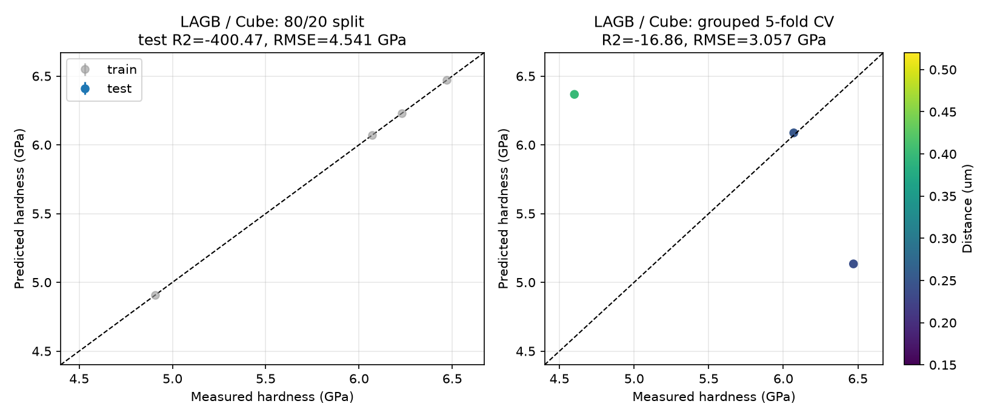
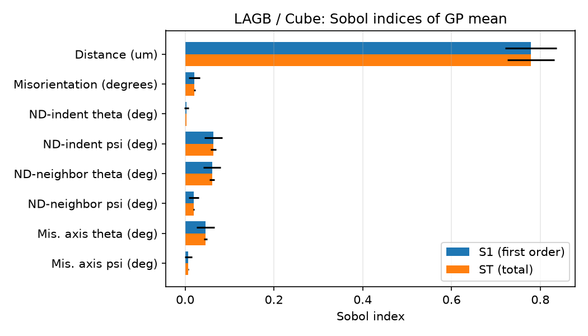
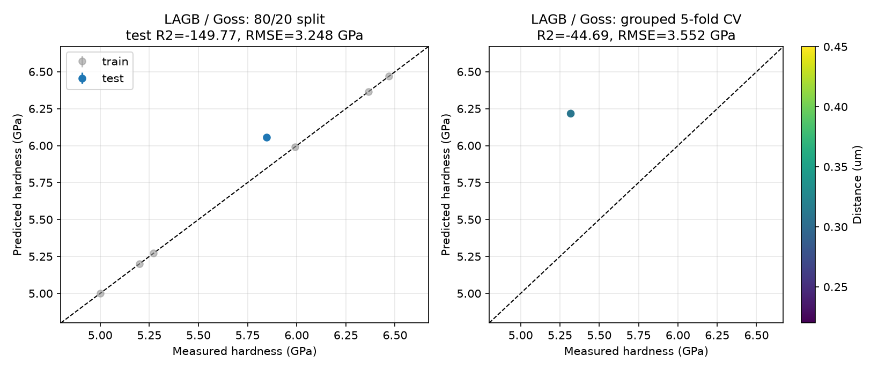
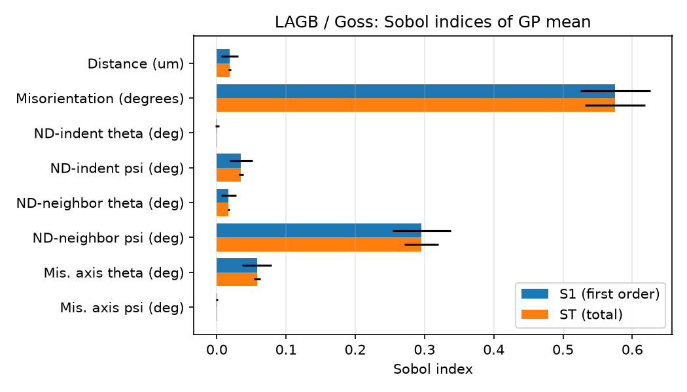
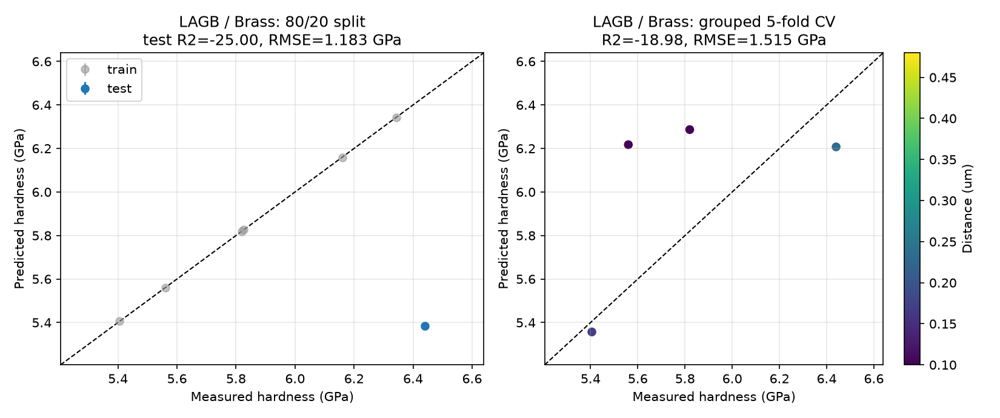
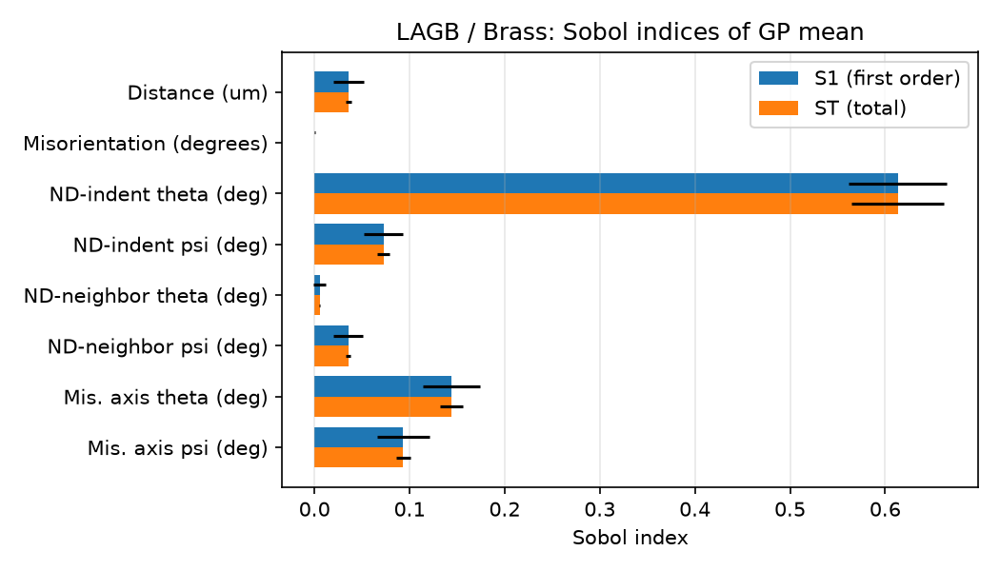
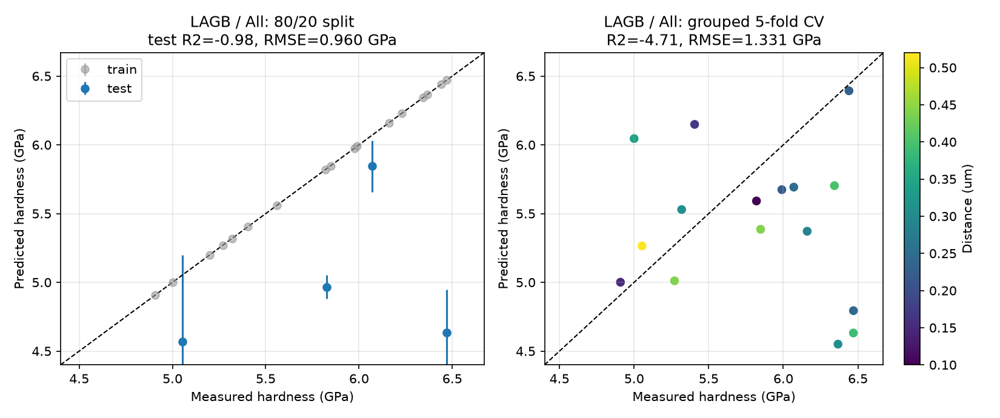
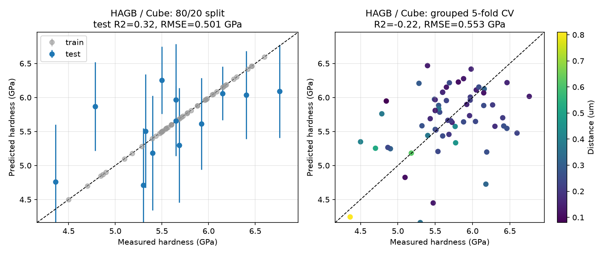
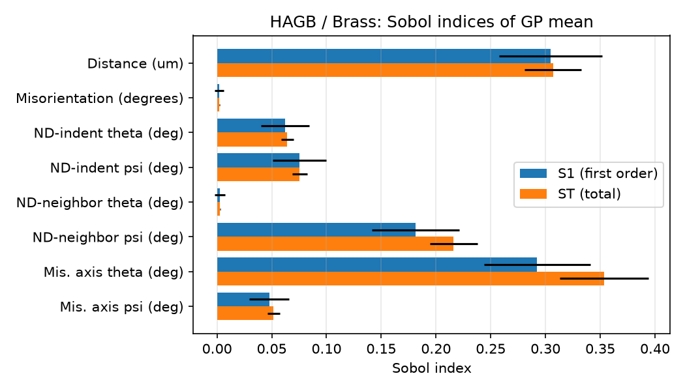

# Hardness vs. grain-boundary character: GP subset study

*Source notebook: `gp_analysis.ipynb` (cells tagged `added-subset-analysis`). Data: `data/Berkovich nanoindentation vs Block Parameters.xlsx`, sheet `H_(E-2)`. All numbers below are generated by those cells; CSVs are in `artifacts/`, figures in `artifacts/figures/`.*

## Summary

* **Distance from the GB is the only input with a consistent, significant relationship to hardness.** In every HAGB subset, hardness decreases with distance (Spearman ρ ≈ −0.3, slope ≈ −1.4 to −1.8 GPa/µm). For HAGB / All, Sobol analysis of both GP variants attributes ~90% of the explained variance to distance.
* **No GP model has useful predictive skill on any subset.** Under grouped cross-validation, the GP setup used in the notebook (Matern-3/2 ARD kernel + linear mean) is worse than predicting the training mean in all 8 subsets. A regularised GP (constant mean, noise floor) beats the mean only for HAGB / All and HAGB / Cube, and even there explains at most ~15% of the variance.
* **The LAGB subsets are far too small to model** (22 indents in total, 6–8 per texture component). Their parity plots, metrics and Sobol indices are reported for completeness but should not be interpreted.
* **Texture component and misorientation show no robust effect.** Neither the ND crystallographic direction (Cube/Goss/Brass) nor the misorientation changes the hardness distribution significantly (Kruskal–Wallis across components p = 0.30 for HAGB; Mann–Whitney LAGB vs HAGB p = 0.25).
* **The notebook's helper functions give wrong orientations.** `rotation_matrix_to_euler`, `project_to_fundamental_zone` and `zone_classifier` are incorrect (details below), so the texture subsets here were recomputed from scratch.

## Data and method

**Data.** 216 indents with complete records (177 distinct indented-grain orientations; several indents share a grain). For each indent: hardness, distance to the GB, misorientation (from the Excel sheet), and Bunge Euler angles of the indented and neighbouring grains.

**Subsets.**
* GB type: **LAGB = misorientation < 15°**, **HAGB = misorientation > 15°**. The request labelled these the other way round ("low misorientation (> 15)"); the standard convention (low-angle boundary < 15°) is used here.
* Texture component of the indented grain: the sample ND (the indentation direction) is expressed in crystal axes and assigned to the nearest of ⟨001⟩ → **Cube**, ⟨011⟩ → **Goss**, ⟨111⟩ → **Brass**, with cubic symmetry handled correctly. This follows the intent of `zone_classifier`, which classifies by ND only. Strictly, Goss {110}⟨001⟩ and Brass {110}⟨112⟩ both have ND ∥ ⟨110⟩, so "Brass" here means ND ∥ ⟨111⟩ (γ-fibre-like).

Indent counts, with distinct indented grains in parentheses:

| Zone | LAGB | HAGB | All |
|---|---|---|---|
| Cube | 6 (6) | 62 (49) | 68 (55) |
| Goss | 8 (8) | 60 (50) | 68 (58) |
| Brass | 8 (8) | 72 (57) | 80 (64) |
| All | 22 (22) | 194 (156) | 216 (177) |

**Inputs (8, symmetry-invariant).** Distance (µm); misorientation (°); ND of the indented grain, ND of the neighbouring grain, and the disorientation axis, each reduced to the cubic standard triangle and given as θ (angle from ⟨001⟩) and ψ (azimuth, 0–45°). These replace the raw Euler angles and the misorientation-axis components used earlier in the notebook. Raw Euler angles are not unique under cubic symmetry: the same crystal can have 24 different Euler triplets, so a kernel distance on them is not physically meaningful. The original 11-feature set is kept as a baseline.

**Model (same as the existing notebook cells).** GPy `GPRegression`, Matern-3/2 kernel with ARD, linear mean function, MinMax scaling of inputs and output, 10 optimiser restarts, 80/20 random split (`random_state=42`).

**Error metrics.** MSE, RMSE, MAE and R² on the training and test sets (R² computed as `r2_score(y_true, y_pred)`), and 95% prediction-interval coverage on the test set. The data contain repeated indents in the same grain, and with so few points a single 80/20 split is unreliable, so all subsets were also evaluated with **grouped 5-fold CV**: indents in the same grain never appear in both train and test folds.

**Sensitivity indices.** Saltelli sampling with N = 1024 (18,432 GP evaluations per subset) over the bounding box of each subset's inputs. First-order (S1) and total-order (ST) Sobol indices of the GP predictive mean, with bootstrap 95% confidence half-widths. ARD length-scales are reported alongside: in scaled units, a large length-scale means the GP ignores that input.

**Robustness checks.**
* A *regularised GP*: constant mean, noise variance ≥ 0.05 in standardised units, length-scales bounded to [0.05, 100].
* Simple reference models under the same grouped CV: training mean, OLS on distance, ridge on all 8 inputs.

## Analysis

### Overview of the data

Hardness distribution per subset:

| Subset | n | mean H | std H | min H | max H |
|---|---|---|---|---|---|
| LAGB / Cube | 6 | 5.555 | 0.792 | 4.600 | 6.470 |
| LAGB / Goss | 8 | 5.683 | 0.562 | 5.000 | 6.469 |
| LAGB / Brass | 8 | 5.941 | 0.362 | 5.406 | 6.440 |
| LAGB / All | 22 | 5.742 | 0.570 | 4.600 | 6.470 |
| HAGB / Cube | 62 | 5.681 | 0.505 | 4.361 | 6.760 |
| HAGB / Goss | 60 | 5.545 | 0.640 | 4.300 | 7.240 |
| HAGB / Brass | 72 | 5.610 | 0.554 | 4.154 | 6.810 |
| HAGB / All | 194 | 5.612 | 0.567 | 4.154 | 7.240 |

*Hardness vs distance (left) and misorientation (middle), and by subset (right). Misorientation is bimodal: LAGBs at 5–15°, and most HAGBs (152 of 194) at 45–62°, the range typical of martensite block boundaries. Only 42 HAGBs fall between 15° and 45°.*

Spearman rank correlation of each input with hardness (* p < 0.05, ** p < 0.01; no multiple-comparison correction):

| Subset | Distance (um) | Misorientation (degrees) | ND-indent theta (deg) | ND-indent psi (deg) | ND-neighbor theta (deg) | ND-neighbor psi (deg) | Mis. axis theta (deg) | Mis. axis psi (deg) |
|---|---|---|---|---|---|---|---|---|
| LAGB / Cube | -0.35 | 0.31 | 0.6 | 0.77 | 0.71 | 0.2 | 0.09 | -0.43 |
| LAGB / Goss | -0.4 | -0.38 | -0.19 | 0.05 | 0.05 | -0.14 | -0.33 | 0.07 |
| LAGB / Brass | 0.56 | 0.29 | 0.19 | -0.38 | 0.12 | -0.33 | 0.05 | -0.4 |
| LAGB / All | -0.2 | 0.16 | 0.21 | 0.31 | 0.31 | 0.08 | -0.24 | -0.31 |
| HAGB / Cube | -0.28* | 0.32* | 0.18 | 0.1 | 0.18 | -0.08 | 0.08 | 0.01 |
| HAGB / Goss | -0.31* | -0.11 | 0.11 | 0.01 | 0.01 | 0.13 | 0.15 | 0.07 |
| HAGB / Brass | -0.31** | -0.21 | 0.01 | 0.03 | -0.03 | 0.07 | -0.14 | -0.2 |
| HAGB / All | -0.29** | -0.02 | -0.03 | 0.07 | 0.07 | 0.08 | 0.05 | -0.06 |

Linear trend of hardness with distance from the GB:

| Subset | slope (GPa/um) | intercept (GPa) | r | p |
|---|---|---|---|---|
| LAGB / Cube | -2.689 | 6.322 | -0.499 | 0.314 |
| LAGB / Goss | -1.817 | 6.341 | -0.264 | 0.527 |
| LAGB / Brass | 1.314 | 5.596 | 0.502 | 0.205 |
| LAGB / All | -0.820 | 5.992 | -0.181 | 0.421 |
| HAGB / Cube | -1.832 | 6.146 | -0.454 | 0.000 |
| HAGB / Goss | -1.824 | 6.022 | -0.385 | 0.002 |
| HAGB / Brass | -1.415 | 5.972 | -0.346 | 0.003 |
| HAGB / All | -1.675 | 6.043 | -0.388 | 0.000 |

### Model performance overview

GP setup from the notebook. Test metrics come from the 80/20 split; CV metrics from grouped K-fold:

| Subset | n | Train RMSE | Train R2 | Test n | Test MSE | Test RMSE | Test MAE | Test R2 | Test 95% PI cov. | CV folds | CV RMSE | CV R2 |
|---|---|---|---|---|---|---|---|---|---|---|---|---|
| LAGB / Cube | 6 | 0.000 | 1.000 | 2 | 20.616 | 4.541 | 4.539 | -400.469 | 0.000 | 5 | 3.057 | -16.861 |
| LAGB / Goss | 8 | 0.000 | 1.000 | 2 | 10.551 | 3.248 | 2.399 | -149.770 | 0.000 | 5 | 3.552 | -44.690 |
| LAGB / Brass | 8 | 0.000 | 1.000 | 2 | 1.400 | 1.183 | 1.177 | -24.997 | 0.000 | 5 | 1.515 | -18.976 |
| LAGB / All | 22 | 0.000 | 1.000 | 5 | 0.922 | 0.960 | 0.775 | -0.980 | 0.200 | 5 | 1.331 | -4.710 |
| HAGB / Cube | 62 | 0.000 | 1.000 | 13 | 0.251 | 0.501 | 0.413 | 0.323 | 0.846 | 5 | 0.553 | -0.218 |
| HAGB / Goss | 60 | 0.597 | 0.191 | 12 | 0.288 | 0.537 | 0.410 | -0.523 | 0.917 | 5 | 0.675 | -0.132 |
| HAGB / Brass | 72 | 0.106 | 0.965 | 15 | 0.235 | 0.485 | 0.455 | -0.076 | 0.800 | 5 | 0.672 | -0.492 |
| HAGB / All | 194 | 0.444 | 0.333 | 39 | 0.377 | 0.614 | 0.522 | 0.062 | 0.923 | 5 | 0.582 | -0.060 |

Grouped-CV comparison with the trivial mean predictor:

| Subset | CV RMSE (mean predictor) | CV RMSE (GP) | GP improvement (%) |
|---|---|---|---|
| LAGB / Cube | 0.921 | 3.057 | -231.971 |
| LAGB / Goss | 0.602 | 3.552 | -490.172 |
| LAGB / Brass | 0.368 | 1.515 | -311.494 |
| LAGB / All | 0.585 | 1.331 | -127.497 |
| HAGB / Cube | 0.510 | 0.553 | -8.471 |
| HAGB / Goss | 0.664 | 0.675 | -1.773 |
| HAGB / Brass | 0.557 | 0.672 | -20.659 |
| HAGB / All | 0.567 | 0.582 | -2.796 |

### Low-angle grain boundaries (misorientation < 15°)

#### LAGB / Cube

n = 6 indents (6 distinct indented grains); 80/20 split → 4 train / 2 test; grouped CV with 5 folds.

| Metric | Value |
|---|---|
| Train RMSE (GPa) | 0.000 |
| Train R² | 1.000 |
| Test RMSE (GPa) | 4.541 |
| Test MAE (GPa) | 4.539 |
| Test R² | -400.469 |
| Test 95% PI coverage | 0.000 |
| Grouped-CV RMSE (GPa) | 3.057 |
| Grouped-CV R² | -16.861 |
| Grouped-CV RMSE, mean predictor (GPa) | 0.921 |
| Grouped-CV R², regularised GP | -1.314 |

*Left: 80/20 split (error bars = ±1.96σ predictive). Right: grouped-CV predictions coloured by distance from the GB.*

| Input | S1 | ±conf | ST | ±conf | ST (reg. GP) | Spearman ρ | p |
|---|---|---|---|---|---|---|---|
| Distance (um) | 0.779 | 0.058 | 0.779 | 0.053 | 0.000 | -0.35 | 0.499 |
| Misorientation (degrees) | 0.021 | 0.013 | 0.021 | 0.002 | 0.437 | 0.31 | 0.544 |
| ND-indent theta (deg) | 0.003 | 0.005 | 0.003 | 0.000 | 0.000 | 0.60 | 0.208 |
| ND-indent psi (deg) | 0.063 | 0.020 | 0.063 | 0.006 | 0.000 | 0.77 | 0.072 |
| ND-neighbor theta (deg) | 0.061 | 0.019 | 0.061 | 0.006 | 0.000 | 0.71 | 0.111 |
| ND-neighbor psi (deg) | 0.020 | 0.012 | 0.020 | 0.002 | 0.000 | 0.20 | 0.704 |
| Mis. axis theta (deg) | 0.046 | 0.021 | 0.046 | 0.004 | 0.795 | 0.09 | 0.872 |
| Mis. axis psi (deg) | 0.007 | 0.008 | 0.007 | 0.001 | 0.000 | -0.43 | 0.397 |

With 6 indents the model is trained on 4 points and tested on 2, while it has 8 ARD length-scales, 8 linear-mean slopes, a variance and a noise term to fit. It interpolates the training points exactly (train R² = 1) and extrapolates badly through the linear mean. Its test and CV errors are several times the spread of the data. The Sobol indices (distance dominant) describe this one interpolant, not the material. The largest Spearman correlations (ND-indent ψ, ND-neighbour θ, ρ ≈ 0.7–0.8) are not significant at n = 6.

#### LAGB / Goss

n = 8 indents (8 distinct indented grains); 80/20 split → 6 train / 2 test; grouped CV with 5 folds.

| Metric | Value |
|---|---|
| Train RMSE (GPa) | 0.000 |
| Train R² | 1.000 |
| Test RMSE (GPa) | 3.248 |
| Test MAE (GPa) | 2.399 |
| Test R² | -149.770 |
| Test 95% PI coverage | 0.000 |
| Grouped-CV RMSE (GPa) | 3.552 |
| Grouped-CV R² | -44.690 |
| Grouped-CV RMSE, mean predictor (GPa) | 0.602 |
| Grouped-CV R², regularised GP | -0.620 |

*Left: 80/20 split (error bars = ±1.96σ predictive). Right: grouped-CV predictions coloured by distance from the GB.*

| Input | S1 | ±conf | ST | ±conf | ST (reg. GP) | Spearman ρ | p |
|---|---|---|---|---|---|---|---|
| Distance (um) | 0.018 | 0.012 | 0.018 | 0.002 | 0.018 | -0.40 | 0.329 |
| Misorientation (degrees) | 0.576 | 0.051 | 0.575 | 0.043 | 0.150 | -0.38 | 0.352 |
| ND-indent theta (deg) | 0.001 | 0.003 | 0.001 | 0.000 | 0.356 | -0.19 | 0.651 |
| ND-indent psi (deg) | 0.035 | 0.017 | 0.035 | 0.003 | 0.535 | 0.05 | 0.911 |
| ND-neighbor theta (deg) | 0.017 | 0.011 | 0.017 | 0.001 | 0.094 | 0.05 | 0.911 |
| ND-neighbor psi (deg) | 0.296 | 0.042 | 0.296 | 0.024 | 0.008 | -0.14 | 0.736 |
| Mis. axis theta (deg) | 0.058 | 0.021 | 0.058 | 0.005 | 1.066 | -0.33 | 0.420 |
| Mis. axis psi (deg) | 0.000 | 0.001 | 0.000 | 0.000 | 0.019 | 0.07 | 0.867 |

Same failure as LAGB / Cube (n = 8, 2 test points), with CV RMSE about 6× the mean-predictor RMSE. The Sobol ranking (misorientation, then ND-neighbour ψ) disagrees completely with the regularised GP (misorientation axis θ, ND-indent ψ). That disagreement is a sign that neither ranking is identifiable from these data. No Spearman correlation is significant.

#### LAGB / Brass

n = 8 indents (8 distinct indented grains); 80/20 split → 6 train / 2 test; grouped CV with 5 folds.

| Metric | Value |
|---|---|
| Train RMSE (GPa) | 0.000 |
| Train R² | 1.000 |
| Test RMSE (GPa) | 1.183 |
| Test MAE (GPa) | 1.177 |
| Test R² | -24.997 |
| Test 95% PI coverage | 0.000 |
| Grouped-CV RMSE (GPa) | 1.515 |
| Grouped-CV R² | -18.976 |
| Grouped-CV RMSE, mean predictor (GPa) | 0.368 |
| Grouped-CV R², regularised GP | -0.578 |

*Left: 80/20 split (error bars = ±1.96σ predictive). Right: grouped-CV predictions coloured by distance from the GB.*

| Input | S1 | ±conf | ST | ±conf | ST (reg. GP) | Spearman ρ | p |
|---|---|---|---|---|---|---|---|
| Distance (um) | 0.036 | 0.016 | 0.036 | 0.003 | 0.078 | 0.56 | 0.146 |
| Misorientation (degrees) | 0.000 | 0.000 | 0.000 | 0.000 | 0.000 | 0.29 | 0.493 |
| ND-indent theta (deg) | 0.613 | 0.052 | 0.613 | 0.049 | 0.000 | 0.19 | 0.651 |
| ND-indent psi (deg) | 0.073 | 0.021 | 0.073 | 0.006 | 0.000 | -0.38 | 0.352 |
| ND-neighbor theta (deg) | 0.005 | 0.006 | 0.005 | 0.000 | 0.000 | 0.12 | 0.779 |
| ND-neighbor psi (deg) | 0.035 | 0.015 | 0.035 | 0.003 | 0.000 | -0.33 | 0.420 |
| Mis. axis theta (deg) | 0.144 | 0.030 | 0.144 | 0.012 | 0.000 | 0.05 | 0.911 |
| Mis. axis psi (deg) | 0.093 | 0.028 | 0.093 | 0.008 | 0.979 | -0.40 | 0.320 |

This subset has the highest mean and the smallest spread of hardness (5.94 ± 0.36 GPa). The GP again fails out of sample. It is the only subset where hardness tends to *increase* with distance (ρ = +0.56, p = 0.15), but n = 8 and the sign is opposite to every HAGB subset, so treat it as noise until there are more indents.

#### LAGB / All

n = 22 indents (22 distinct indented grains); 80/20 split → 17 train / 5 test; grouped CV with 5 folds.

| Metric | Value |
|---|---|
| Train RMSE (GPa) | 0.000 |
| Train R² | 1.000 |
| Test RMSE (GPa) | 0.960 |
| Test MAE (GPa) | 0.775 |
| Test R² | -0.980 |
| Test 95% PI coverage | 0.200 |
| Grouped-CV RMSE (GPa) | 1.331 |
| Grouped-CV R² | -4.710 |
| Grouped-CV RMSE, mean predictor (GPa) | 0.585 |
| Grouped-CV R², regularised GP | -0.411 |

*Left: 80/20 split (error bars = ±1.96σ predictive). Right: grouped-CV predictions coloured by distance from the GB.*

| Input | S1 | ±conf | ST | ±conf | ST (reg. GP) | Spearman ρ | p |
|---|---|---|---|---|---|---|---|
| Distance (um) | 0.097 | 0.035 | 0.132 | 0.019 | 0.012 | -0.20 | 0.383 |
| Misorientation (degrees) | 0.209 | 0.046 | 0.245 | 0.023 | 0.600 | 0.16 | 0.487 |
| ND-indent theta (deg) | 0.015 | 0.012 | 0.015 | 0.001 | 0.000 | 0.21 | 0.347 |
| ND-indent psi (deg) | 0.005 | 0.007 | 0.005 | 0.001 | 0.000 | 0.31 | 0.164 |
| ND-neighbor theta (deg) | 0.218 | 0.037 | 0.218 | 0.020 | 0.652 | 0.31 | 0.160 |
| ND-neighbor psi (deg) | 0.005 | 0.006 | 0.005 | 0.000 | 0.645 | 0.08 | 0.732 |
| Mis. axis theta (deg) | 0.217 | 0.038 | 0.216 | 0.019 | 0.000 | -0.24 | 0.289 |
| Mis. axis psi (deg) | 0.196 | 0.034 | 0.197 | 0.019 | 0.000 | -0.31 | 0.162 |

Pooling all 22 LAGB indents does not help. Test R² is about −1 and CV R² is strongly negative, while the mean predictor gets CV RMSE ≈ 0.59 GPa. The Sobol indices spread across misorientation, ND-neighbour θ and the axis angles, which is what a model that has not found a signal looks like. No Spearman correlation is significant.

### High-angle grain boundaries (misorientation > 15°)

#### HAGB / Cube

n = 62 indents (49 distinct indented grains); 80/20 split → 49 train / 13 test; grouped CV with 5 folds.

| Metric | Value |
|---|---|
| Train RMSE (GPa) | 0.000 |
| Train R² | 1.000 |
| Test RMSE (GPa) | 0.501 |
| Test MAE (GPa) | 0.413 |
| Test R² | 0.323 |
| Test 95% PI coverage | 0.846 |
| Grouped-CV RMSE (GPa) | 0.553 |
| Grouped-CV R² | -0.218 |
| Grouped-CV RMSE, mean predictor (GPa) | 0.510 |
| Grouped-CV R², regularised GP | 0.100 |

*Left: 80/20 split (error bars = ±1.96σ predictive). Right: grouped-CV predictions coloured by distance from the GB.*

| Input | S1 | ±conf | ST | ±conf | ST (reg. GP) | Spearman ρ | p |
|---|---|---|---|---|---|---|---|
| Distance (um) | 0.168 | 0.033 | 0.170 | 0.016 | 0.224 | -0.28 | 0.026 |
| Misorientation (degrees) | 0.311 | 0.053 | 0.455 | 0.054 | 0.202 | 0.32 | 0.011 |
| ND-indent theta (deg) | 0.041 | 0.019 | 0.046 | 0.005 | 0.000 | 0.18 | 0.167 |
| ND-indent psi (deg) | 0.018 | 0.012 | 0.019 | 0.002 | 0.000 | 0.10 | 0.453 |
| ND-neighbor theta (deg) | 0.087 | 0.043 | 0.223 | 0.032 | 0.698 | 0.18 | 0.160 |
| ND-neighbor psi (deg) | 0.036 | 0.016 | 0.037 | 0.004 | 0.136 | -0.08 | 0.527 |
| Mis. axis theta (deg) | 0.204 | 0.036 | 0.205 | 0.019 | 0.000 | 0.08 | 0.560 |
| Mis. axis psi (deg) | 0.000 | 0.001 | 0.000 | 0.000 | 0.000 | 0.01 | 0.950 |

The 80/20 split looks encouraging (test R² = 0.32), but grouped CV is negative (−0.22): the single split was lucky. Distance (ρ = −0.28) and misorientation (ρ = +0.32) are both significant at p < 0.05. Ridge and distance-only OLS reach CV R² ≈ 0.16, and the regularised GP is one of only two settings that beat the mean predictor. The two GP variants disagree on the dominant input (misorientation vs ND-neighbour θ), so only the presence of a weak distance and misorientation effect is supported.

#### HAGB / Goss

n = 60 indents (50 distinct indented grains); 80/20 split → 48 train / 12 test; grouped CV with 5 folds.

| Metric | Value |
|---|---|
| Train RMSE (GPa) | 0.597 |
| Train R² | 0.191 |
| Test RMSE (GPa) | 0.537 |
| Test MAE (GPa) | 0.410 |
| Test R² | -0.523 |
| Test 95% PI coverage | 0.917 |
| Grouped-CV RMSE (GPa) | 0.675 |
| Grouped-CV R² | -0.132 |
| Grouped-CV RMSE, mean predictor (GPa) | 0.664 |
| Grouped-CV R², regularised GP | -0.212 |

*Left: 80/20 split (error bars = ±1.96σ predictive). Right: grouped-CV predictions coloured by distance from the GB.*

| Input | S1 | ±conf | ST | ±conf | ST (reg. GP) | Spearman ρ | p |
|---|---|---|---|---|---|---|---|
| Distance (um) | 0.205 | 0.041 | 0.205 | 0.018 | 0.978 | -0.31 | 0.016 |
| Misorientation (degrees) | 0.072 | 0.021 | 0.072 | 0.007 | 0.000 | -0.11 | 0.405 |
| ND-indent theta (deg) | 0.019 | 0.013 | 0.019 | 0.002 | 0.000 | 0.11 | 0.403 |
| ND-indent psi (deg) | 0.000 | 0.000 | 0.000 | 0.000 | 0.112 | 0.01 | 0.968 |
| ND-neighbor theta (deg) | 0.087 | 0.026 | 0.087 | 0.007 | 0.000 | 0.01 | 0.951 |
| ND-neighbor psi (deg) | 0.012 | 0.010 | 0.012 | 0.001 | 0.000 | 0.13 | 0.320 |
| Mis. axis theta (deg) | 0.588 | 0.055 | 0.588 | 0.048 | 0.000 | 0.15 | 0.253 |
| Mis. axis psi (deg) | 0.017 | 0.010 | 0.017 | 0.002 | 0.000 | 0.07 | 0.582 |

The ML-II fit puts most of the variance into noise (train R² = 0.19), and the model still does slightly worse than the mean in CV. The original GP attributes 59% of the variance to the misorientation-axis polar angle, but the regularised GP, which also fails to beat the mean, gives 98% to distance. Only distance is significantly correlated with hardness (ρ = −0.31).

#### HAGB / Brass

n = 72 indents (57 distinct indented grains); 80/20 split → 57 train / 15 test; grouped CV with 5 folds.

| Metric | Value |
|---|---|
| Train RMSE (GPa) | 0.106 |
| Train R² | 0.965 |
| Test RMSE (GPa) | 0.485 |
| Test MAE (GPa) | 0.455 |
| Test R² | -0.076 |
| Test 95% PI coverage | 0.800 |
| Grouped-CV RMSE (GPa) | 0.672 |
| Grouped-CV R² | -0.492 |
| Grouped-CV RMSE, mean predictor (GPa) | 0.557 |
| Grouped-CV R², regularised GP | -0.339 |

*Left: 80/20 split (error bars = ±1.96σ predictive). Right: grouped-CV predictions coloured by distance from the GB.*

| Input | S1 | ±conf | ST | ±conf | ST (reg. GP) | Spearman ρ | p |
|---|---|---|---|---|---|---|---|
| Distance (um) | 0.305 | 0.047 | 0.307 | 0.026 | 0.954 | -0.31 | 0.007 |
| Misorientation (degrees) | 0.002 | 0.004 | 0.002 | 0.000 | 0.000 | -0.21 | 0.082 |
| ND-indent theta (deg) | 0.062 | 0.022 | 0.064 | 0.006 | 0.206 | 0.01 | 0.944 |
| ND-indent psi (deg) | 0.075 | 0.025 | 0.076 | 0.007 | 0.000 | 0.03 | 0.819 |
| ND-neighbor theta (deg) | 0.003 | 0.005 | 0.003 | 0.000 | 0.000 | -0.03 | 0.779 |
| ND-neighbor psi (deg) | 0.181 | 0.040 | 0.216 | 0.022 | 0.000 | 0.07 | 0.582 |
| Mis. axis theta (deg) | 0.292 | 0.049 | 0.354 | 0.041 | 0.000 | -0.14 | 0.250 |
| Mis. axis psi (deg) | 0.048 | 0.018 | 0.052 | 0.005 | 0.027 | -0.20 | 0.093 |

The GP overfits (train R² = 0.97, CV R² = −0.49). The best model here is a one-dimensional GP on distance only (CV R² ≈ 0.11). Distance is the only significant correlate (ρ = −0.31, p < 0.01). The original GP's weight on the misorientation axis θ and ND-neighbour ψ is not reproduced by the regularised GP (distance 0.95).

#### HAGB / All

n = 194 indents (156 distinct indented grains); 80/20 split → 155 train / 39 test; grouped CV with 5 folds.

| Metric | Value |
|---|---|
| Train RMSE (GPa) | 0.444 |
| Train R² | 0.333 |
| Test RMSE (GPa) | 0.614 |
| Test MAE (GPa) | 0.522 |
| Test R² | 0.062 |
| Test 95% PI coverage | 0.923 |
| Grouped-CV RMSE (GPa) | 0.582 |
| Grouped-CV R² | -0.060 |
| Grouped-CV RMSE, mean predictor (GPa) | 0.567 |
| Grouped-CV R², regularised GP | 0.133 |

*Left: 80/20 split (error bars = ±1.96σ predictive). Right: grouped-CV predictions coloured by distance from the GB.*

| Input | S1 | ±conf | ST | ±conf | ST (reg. GP) | Spearman ρ | p |
|---|---|---|---|---|---|---|---|
| Distance (um) | 0.835 | 0.063 | 0.893 | 0.067 | 0.934 | -0.29 | 0.000 |
| Misorientation (degrees) | 0.000 | 0.001 | 0.000 | 0.000 | 0.000 | -0.02 | 0.786 |
| ND-indent theta (deg) | 0.000 | 0.001 | 0.000 | 0.000 | 0.000 | -0.03 | 0.711 |
| ND-indent psi (deg) | 0.002 | 0.003 | 0.001 | 0.000 | 0.000 | 0.07 | 0.357 |
| ND-neighbor theta (deg) | 0.001 | 0.002 | 0.001 | 0.000 | 0.000 | 0.07 | 0.364 |
| ND-neighbor psi (deg) | 0.016 | 0.010 | 0.016 | 0.001 | 0.043 | 0.08 | 0.275 |
| Mis. axis theta (deg) | 0.073 | 0.021 | 0.073 | 0.006 | 0.028 | 0.05 | 0.528 |
| Mis. axis psi (deg) | 0.013 | 0.021 | 0.065 | 0.006 | 0.009 | -0.06 | 0.386 |

With the most data (194 indents, 156 grains), every sensitivity analysis agrees that distance from the GB dominates: original GP ST = 0.89, regularised GP ST = 0.93, and Spearman ρ = −0.29 with p < 0.001. The original GP still does not beat the mean in CV (R² = −0.06). The regularised GP (8 features) and the distance-only GP reach CV R² ≈ 0.13–0.15. The hardness gradient is ≈ −1.7 GPa/µm.

### Sensitivity indices across subsets

Total-order Sobol indices, GP setup from the notebook:

| Subset | Distance (um) | Misorientation (degrees) | ND-indent theta (deg) | ND-indent psi (deg) | ND-neighbor theta (deg) | ND-neighbor psi (deg) | Mis. axis theta (deg) | Mis. axis psi (deg) |
|---|---|---|---|---|---|---|---|---|
| LAGB / Cube | 0.779 | 0.021 | 0.003 | 0.063 | 0.061 | 0.020 | 0.046 | 0.007 |
| LAGB / Goss | 0.018 | 0.575 | 0.001 | 0.035 | 0.017 | 0.296 | 0.058 | 0.000 |
| LAGB / Brass | 0.036 | 0.000 | 0.613 | 0.073 | 0.005 | 0.035 | 0.144 | 0.093 |
| LAGB / All | 0.132 | 0.245 | 0.015 | 0.005 | 0.218 | 0.005 | 0.216 | 0.197 |
| HAGB / Cube | 0.170 | 0.455 | 0.046 | 0.019 | 0.223 | 0.037 | 0.205 | 0.000 |
| HAGB / Goss | 0.205 | 0.072 | 0.019 | 0.000 | 0.087 | 0.012 | 0.588 | 0.017 |
| HAGB / Brass | 0.307 | 0.002 | 0.064 | 0.076 | 0.003 | 0.216 | 0.354 | 0.052 |
| HAGB / All | 0.893 | 0.000 | 0.000 | 0.001 | 0.001 | 0.016 | 0.073 | 0.065 |

First-order Sobol indices, GP setup from the notebook:

| Subset | Distance (um) | Misorientation (degrees) | ND-indent theta (deg) | ND-indent psi (deg) | ND-neighbor theta (deg) | ND-neighbor psi (deg) | Mis. axis theta (deg) | Mis. axis psi (deg) |
|---|---|---|---|---|---|---|---|---|
| LAGB / Cube | 0.779 | 0.021 | 0.003 | 0.063 | 0.061 | 0.020 | 0.046 | 0.007 |
| LAGB / Goss | 0.018 | 0.576 | 0.001 | 0.035 | 0.017 | 0.296 | 0.058 | 0.000 |
| LAGB / Brass | 0.036 | 0.000 | 0.613 | 0.073 | 0.005 | 0.035 | 0.144 | 0.093 |
| LAGB / All | 0.097 | 0.209 | 0.015 | 0.005 | 0.218 | 0.005 | 0.217 | 0.196 |
| HAGB / Cube | 0.168 | 0.311 | 0.041 | 0.018 | 0.087 | 0.036 | 0.204 | 0.000 |
| HAGB / Goss | 0.205 | 0.072 | 0.019 | 0.000 | 0.087 | 0.012 | 0.588 | 0.017 |
| HAGB / Brass | 0.305 | 0.002 | 0.062 | 0.075 | 0.003 | 0.181 | 0.292 | 0.048 |
| HAGB / All | 0.835 | 0.000 | 0.000 | 0.002 | 0.001 | 0.016 | 0.073 | 0.013 |

Total-order Sobol indices, regularised GP. The last column marks whether that model beats the mean predictor in grouped CV, i.e. whether its indices are worth interpreting:

| Subset | Distance (um) | Misorientation (degrees) | ND-indent theta (deg) | ND-indent psi (deg) | ND-neighbor theta (deg) | ND-neighbor psi (deg) | Mis. axis theta (deg) | Mis. axis psi (deg) | beats mean in CV |
|---|---|---|---|---|---|---|---|---|---|
| LAGB / Cube | 0.000 | 0.437 | 0.000 | 0.000 | 0.000 | 0.000 | 0.795 | 0.000 | False |
| LAGB / Goss | 0.018 | 0.150 | 0.356 | 0.535 | 0.094 | 0.008 | 1.066 | 0.019 | False |
| LAGB / Brass | 0.078 | 0.000 | 0.000 | 0.000 | 0.000 | 0.000 | 0.000 | 0.979 | False |
| LAGB / All | 0.012 | 0.600 | 0.000 | 0.000 | 0.652 | 0.645 | 0.000 | 0.000 | False |
| HAGB / Cube | 0.224 | 0.202 | 0.000 | 0.000 | 0.698 | 0.136 | 0.000 | 0.000 | True |
| HAGB / Goss | 0.978 | 0.000 | 0.000 | 0.112 | 0.000 | 0.000 | 0.000 | 0.000 | False |
| HAGB / Brass | 0.954 | 0.000 | 0.206 | 0.000 | 0.000 | 0.000 | 0.000 | 0.027 | False |
| HAGB / All | 0.934 | 0.000 | 0.000 | 0.000 | 0.000 | 0.043 | 0.028 | 0.009 | True |

### Robustness checks

**Model comparison (grouped CV R²).** Positive values mean better than predicting the training mean.

| Subset | mean | OLS (distance) | Ridge (8 feat.) | GP-reg (distance) | GP-reg (8 feat.) | GP (orig. setup) |
|---|---|---|---|---|---|---|
| LAGB / Cube | -0.621 | -0.652 | -1.345 | -0.976 | -1.314 | -16.861 |
| LAGB / Goss | -0.312 | -0.654 | -0.335 | -0.312 | -0.620 | -44.690 |
| LAGB / Brass | -0.180 | -0.422 | -1.409 | -0.177 | -0.578 | -18.976 |
| LAGB / All | -0.103 | -0.256 | -0.240 | -0.182 | -0.411 | -4.710 |
| HAGB / Cube | -0.035 | 0.159 | 0.165 | 0.045 | 0.100 | -0.218 |
| HAGB / Goss | -0.093 | 0.020 | -0.116 | -0.077 | -0.212 | -0.132 |
| HAGB / Brass | -0.025 | 0.071 | -0.066 | 0.109 | -0.339 | -0.492 |
| HAGB / All | -0.003 | 0.129 | 0.099 | 0.148 | 0.133 | -0.060 |

Grouped-CV RMSE (GPa):

| Subset | mean | OLS (distance) | Ridge (8 feat.) | GP-reg (distance) | GP-reg (8 feat.) | GP (orig. setup) |
|---|---|---|---|---|---|---|
| LAGB / Cube | 0.921 | 0.930 | 1.108 | 1.017 | 1.100 | 3.057 |
| LAGB / Goss | 0.602 | 0.676 | 0.607 | 0.602 | 0.669 | 3.552 |
| LAGB / Brass | 0.368 | 0.404 | 0.526 | 0.368 | 0.426 | 1.515 |
| LAGB / All | 0.585 | 0.624 | 0.620 | 0.606 | 0.662 | 1.331 |
| HAGB / Cube | 0.510 | 0.460 | 0.458 | 0.490 | 0.476 | 0.553 |
| HAGB / Goss | 0.664 | 0.628 | 0.671 | 0.659 | 0.699 | 0.675 |
| HAGB / Brass | 0.557 | 0.530 | 0.568 | 0.519 | 0.636 | 0.672 |
| HAGB / All | 0.567 | 0.528 | 0.537 | 0.522 | 0.527 | 0.582 |

**Original 11-feature input set** (raw Euler angles plus the misorientation axis from the notebook's FZ-projected matrices) vs the symmetry-invariant set:

| Subset | Test RMSE (orig) | Test R2 (orig) | CV RMSE (orig) | CV R2 (orig) | Test R2 (invariant) | CV R2 (invariant) |
|---|---|---|---|---|---|---|
| LAGB / Cube | 1.686 | -54.334 | 2.340 | -9.463 | -400.469 | -16.861 |
| LAGB / Goss | 1.604 | -35.786 | 2.428 | -20.356 | -149.770 | -44.690 |
| LAGB / Brass | 1.187 | -25.157 | 1.940 | -31.750 | -24.997 | -18.976 |
| LAGB / All | 1.111 | -1.653 | 1.313 | -4.558 | -0.980 | -4.710 |
| HAGB / Cube | 0.557 | 0.166 | 0.513 | -0.048 | 0.323 | -0.218 |
| HAGB / Goss | 0.669 | -1.362 | 0.681 | -0.150 | -0.523 | -0.132 |
| HAGB / Brass | 0.633 | -0.832 | 0.775 | -0.990 | -0.076 | -0.492 |
| HAGB / All | 0.559 | 0.225 | 0.567 | -0.004 | 0.062 | -0.060 |

### Data and code consistency checks

* `zone_classifier` vs the corrected ND classification agree on only 35% of indents:

| zone_classifier \ corrected | Brass | Cube | Goss | All |
|---|---|---|---|---|
| Brass | 17 | 10 | 13 | 40 |
| Cube | 56 | 51 | 47 | 154 |
| Goss | 7 | 7 | 8 | 22 |
| All | 80 | 68 | 68 | 216 |

* Disorientation computed from the two grains' Euler angles vs the Excel misorientation column: median difference 1.8°, 90th percentile 6.0°, maximum 38.9°. 99 of 216 rows differ by more than 2°, and 8 rows would switch GB type (LAGB ↔ HAGB) if the computed value were used. The subsets use the Excel value.

## Discussion

**1. The only reproducible signal is a hardness decrease away from HAGBs, and it is small.** In all three HAGB texture subsets, hardness falls with distance from the boundary. The slopes are very similar (−1.8, −1.8 and −1.4 GPa/µm for Cube, Goss and Brass; r = −0.35 to −0.45; p ≤ 0.003). Distance is also the only input that every method ranks first for HAGB / All: Spearman, OLS, the original GP's Sobol index (ST = 0.89), the regularised GP's (0.93), and the ARD length-scales (0.5 for distance vs > 2,000 for most other inputs). This is consistent with boundary strengthening: when the indent sits within a few hundred nanometres of a boundary, its plastic zone reaches the boundary, and dislocation pile-up or blocked slip transfer raises the measured hardness. The texture component does not change the gradient appreciably, which suggests the effect comes from the boundary rather than from the indented crystal's orientation.

The effect is nonetheless weak. The best cross-validated models (distance-only GP or regularised GP on HAGB / All) explain about 13–15% of the variance, and the residual RMSE (≈ 0.52 GPa) is close to the raw standard deviation (0.57 GPa). Only 10 indents lie beyond 0.5 µm, so the far-field (bulk) hardness is poorly constrained; the apparent gradient rests largely on these few far-from-boundary points.

**2. Texture component and misorientation have no detectable effect.** Hardness distributions overlap almost completely across Cube, Goss and Brass, for HAGB alone and for all data (Kruskal–Wallis p = 0.30 and 0.39). LAGB and HAGB do not differ either (Mann–Whitney p = 0.25). Weak Berkovich-hardness anisotropy in a cubic metal is expected: the three-sided pyramid activates many slip systems whatever the ND direction. Misorientation is significant only in HAGB / Cube (ρ = +0.32). That subset test is one of 64 run at α = 0.05, where about 3 false positives are expected by chance, and the regularised GP does not reproduce it as the leading input. It should be treated as a hypothesis. The bimodal misorientation distribution (5–15° and, for 78% of HAGBs, 45–62°) also means misorientation within a GB type spans a narrow range, so a continuous misorientation effect is hard to resolve with these data.

**3. Why the GPs fail, and what the Sobol indices mean.**
* *Overfitting.* With MinMax-scaled outputs and no noise prior, maximum-likelihood fitting drives the noise variance to almost zero in most subsets. The model then interpolates the training data (train R² = 1.000 in five of the eight subsets) and reverts to the mean, or to the linear mean function, away from them.
* *Linear mean in tiny subsets.* With 4–6 training points and 8 free slopes, the linear mean is unconstrained. It extrapolates to errors of 1–4.5 GPa on held-out LAGB indents, which explains the very negative test R² values (down to −400). The constant-mean, noise-floored GP removes these failures but still cannot beat the mean on the LAGB subsets.
* *A single split is misleading.* HAGB / Cube has test R² = +0.32 on its 80/20 split but −0.22 under grouped CV. The split metrics in the parity plots should be read together with the CV metrics.
* *Sobol indices are properties of the fitted model, not the material.* They are interpretable only where the model generalises. Wherever it does not, the indices change completely between equally poor models. For example, HAGB / Goss gets misorientation-axis θ = 0.59 from one GP and distance = 0.98 from the other. Only HAGB / All (and, weakly, HAGB / Cube) pass the "beats the mean" test, and for HAGB / All both GPs agree on distance. The Sobol sampling also draws inputs independently and uniformly over a bounding box, while the real inputs are correlated (e.g. the misorientation axis and angle depend on both grain orientations) and the standard triangle is not a rectangle. Part of the sampled space is therefore off-data, where the GP just returns its prior mean.
* *Original vs invariant features.* With raw Euler angles, the GP does no better (HAGB / All CV R² −0.004 vs −0.060) and is just as unstable. Neither input set contains GB-orientation information the GP can exploit at this sample size.

**4. LAGB subsets: descriptive only.** 22 indents spread over 3 components (6–8 per component, one indent per grain) cannot support an 8-input regression. The per-component parity plots and Sobol indices are reported as requested but carry no information about the material. Pooled LAGB statistics show no significant correlation with any input.

**5. Recommendations.**
1. Fix the orientation helpers before reusing any texture labels or misorientation axes from them (see next section).
2. Model with fewer, physically motivated inputs. Candidates: distance (or distance normalised by indentation depth or plastic-zone size, if available), the GB-type indicator, and slip-transfer metrics such as Schmid factors of the two grains or the Luster–Morris m′ parameter. These describe how easily a boundary transmits slip better than misorientation angle or axis.
3. Pool the subsets and include component and GB type as inputs instead of fitting 8 separate models. Fix or regularise the GP noise and drop the linear mean.
4. Collect more indents next to LAGBs (at least 30–50 per component) and more indents far (> 0.5 µm) from boundaries, to pin down the bulk hardness and the length scale of the gradient.
5. Resolve the 8 indents whose GB type depends on whether misorientation is taken from the Excel column or computed from the Euler angles, and the rows where the two differ by more than 5°.

## Issues found in the existing code

| Location | Issue | Effect |
|---|---|---|
| `scripts/utils/rotation_matrix.py::rotation_matrix` | Returns gᵀ (crystal → sample), not Bunge's passive g. | Not wrong in itself, but every downstream function must use the same convention. |
| `scripts/utils/rotation_matrix.py::rotation_matrix_to_euler` | Inverts g, not the gᵀ that `rotation_matrix` returns, so `rotation_matrix(*rotation_matrix_to_euler(R)) != R` (500/500 random tests). | All Euler angles produced from matrices are wrong. |
| `scripts/utils/fundamental_zone.py::project_to_fundamental_zone` | Uses the broken inverse. Pre-multiplies gᵀ by the operator, which is a *sample* operation in this convention. Overwrites `phi1, Phi, phi2` inside the loop, so operators are chained rather than each applied to the original. On failure, returns the last chained result instead of the input. | In random tests the output lies in the FZ only ~50% of the time and is symmetry-equivalent to the input only ~60% of the time. |
| `scripts/utils/scratch.py::zone_classifier` | Depends on `project_to_fundamental_zone`. Measures "Cube" against crystal [100], whereas within the FZ the ND lies closest to [010]. Labels ND ∥ ⟨111⟩ as "Brass". | Agrees with a symmetry-correct ND classification on only 35% of indents. |
| Notebook cell computing misorientation axes | Uses FZ-projected (wrong) matrices and takes the axis of one arbitrary symmetric variant rather than the disorientation. | The "Misorientation axis 1–3" inputs are not physically meaningful. |
| Notebook performance cell | Test R² computed as `r2_score(ytest_pred_original, outputs_test)`, with the arguments swapped. | The reported test R² is not the coefficient of determination of the predictions. |
| Notebook cell `inputs, outputs = df.iloc[:, 3:-1]…` | Its saved output is a `ValueError` on the string "Cube" (apparently the "Zone" column was among the inputs on that run). Later cells show outputs from an earlier state. | The notebook as saved is not reproducible top-to-bottom. |

## Reproduction

The added cells are self-contained: they re-read the Excel file. Run them after the existing cells, or on their own from the first added cell. Full runtime is about 5 minutes on 8 cores. Seeds are fixed (`SEED = 42`). Outputs:

* `artifacts/features_all.csv`: all indents with derived features, both zone labels and GB type
* `artifacts/metrics.csv`, `gp_vs_mean_predictor.csv`, `model_comparison_cv_*.csv`, `metrics_baseline_original_features.csv`
* `artifacts/sobol_<subset>.csv`, `sobol_ST_all_subsets.csv`, `sobol_S1_all_subsets.csv`, `sobol_ST_regularised_gp.csv`, `ard_lengthscales.csv`
* `artifacts/spearman_rho.csv`, `spearman_p.csv`, `distance_trend.csv`, `hardness_by_subset.csv`
* `artifacts/figures/*.png`, `artifacts/tables/*.md`
